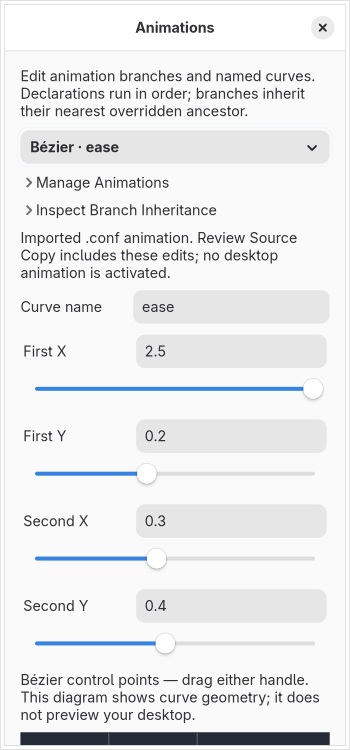

# Animation draft editor

## Existing `.conf` animations

Literal `bezier` and `animation` declarations at the top level or inside a flat `animations { … }` category now populate the graphical editor. Use the declaration picker to change a curve or branch. **Manage Animations** contains add, duplicate, remove, reorder and undo controls that wrap on small windows. The first declaration receives initial selection.

Native Bézier coordinates and positive speeds use the native float32 domain rather than the Lua API's coordinate and speed limits. Native values are shown in their short float32 spelling, while unchanged source statements retain their original bytes. Sliders include imported values beyond the common range and the control-point diagram expands to show them. Source numeric acceptance follows the pinned decimal predicate; exponent and leading-plus spellings remain unresolved in imported native syntax. New graphical numeric input is emitted using native-compatible decimal spelling. Non-finite, overflow and underflow values are refused.

A disabled native branch ignores timing, curve and style arguments. Those optional arguments remain stored, including otherwise invalid ignored text. Enabling it requires valid timing and an earlier native Bézier reference. Native and separate Lua drafts have independent registries. There is no native spring declaration handler; new spring authoring is unavailable in a `.conf` project, while older separate Lua spring drafts remain retained for explicit review.

**Review Source Copy** includes native animation edits alongside scalar, session, monitor, binding and workspace edits. Changed statements use canonical native arguments; untouched statements, comments, category braces, unresolved lines and line endings remain. The complete copy is reparsed before review. Native comma arguments have no escaped-comma form; unrepresentable values can remain private drafts but cannot produce a misleading copy.

Save Draft records captured-source/codec identities even for an intentional empty animation target. Older projects rebuild recognized native source declarations and retain their separate Lua drafts with distinct identities. Old files and recorded original paths stay untouched. Native declarations require explicit conversion before Lua/preview emission; ordinary preview preparation records their omission without curve-name or style payloads. Editing does not activate animations or reload the compositor.

Variables, includes, expressions, conditional/continued/qualified syntax, other category placements, arbitrary native numeric aliases, complete effective-state discovery and native renderer/interpolation behavior remain unverified. The diagram remains a geometry aid. Actual isolated compositor preview, live apply/recovery and full resource/accessibility/security/release acceptance remain required. The native profile pins the handler, lexer and argument-splitter sources in `data/legacy-animations.json`.

## Lua drafts

The 0.11 editor authors ordered private `hl.curve` and `hl.animation` drafts for the two audited Hyprland source snapshots. It includes all 34 public animation nodes per snapshot and labels the separately discovered internal `__internal_fadeCTM` node. Internal names are unstable implementation details. This milestone does not certify any complete animation contract or desktop behavior.

## Editing and inheritance

Add Bézier curves, springs or branch overrides; duplicate, remove, reorder and undo declarations. Duplicate curves receive independent names. A branch picker covers the full pinned tree. Enabled branches have speed, curve reference and style controls. Style presets are filtered by the node's actual validator; uncommon accepted strings remain editable and preserved. An inheritance inspector shows each branch's resolved draft origin, enabled state, curve, style and timing. Removing a declaration restores the preceding override or inherited built-in defaults; it does not invoke a compositor unset operation.

Overrides replace the entire node configuration. Descendants inherit their nearest overridden ancestor, except built-in angle overrides, which start disabled. Disabled calls use speed 1, the default curve and empty style; optional imported fields are retained even when ignored. Required `enabled` is not inferred from the descriptor's constructor default. Named curves must exist before an enabled branch references them. The two registries are distinct: a Bézier reference wins when both reference fields exist. Later definitions replace a curve's registry entry. The `spring:` prefix has runtime meaning even for a Bézier name; the findings explain this quirk.

Bézier coordinates have sliders, exact numeric entries and draggable handles in -1..2. The diagram plots parametric control-point geometry. Hyprutils evaluates a baked inverse-x curve; the diagram is not a runtime interpolation certificate or isolated compositor preview. No idle animation playback or background frame loop is started. Spring stiffness/damping/mass have numeric entries and GUI stepping without a fabricated upper bound. Untouched bool/numeric-string representations stay unchanged. The supported model requires finite float32 numbers; exotic numeric strings and non-finite/out-of-domain source values remain unresolved source with diagnostics.

The public API uses speed. The inspected Hyprutils progress code computes elapsed milliseconds divided by `100 × speed`, so the UI explains the corresponding Bézier duration. Springs advance a physical integration and finish by position/velocity thresholds, not that duration. This is source-derived timing; actual scheduling, renderer behavior and frame pacing remain unverified. The baseline spring API requires `dampening`; the newer snapshot accepts `damping` and its old alias. Export respects the stored version spelling. Source float bounds are checked before float32 conversion; spring limits are checked after conversion and are strictly greater than 0.5 despite the error message's wording.

## Source, storage and security

Static import handles literal declarations and the existing restricted pure-local projection. It never executes Lua. Evaluated arguments and unknown fields remain unresolved and retain their source bytes. Declarations flow through the existing bounded, isolated parser, source snapshots, versioned state, generation checks, unsaved-change tracking and history. Private `.hye` snapshots pin the animation schema, and reopening reparses saved source without opening the recorded path. Headless checks report animation declaration counts. Export preserves declaration order, including curve creation order. A scalar-only source copy is refused when it would omit changed animation drafts.

The model caps a program at 1,024 declarations, 1 MiB serialized size and 16 KiB per text field. Existing workspace, worker and history budgets still apply. Only the selected form is constructed, and closed-editor state release is checked in the native fixture. These controls contain no compositor mutation, command execution, plugin loading or input/hardware service. Full isolation, accessibility and resource release gates still require broader verification.

## Evidence and remaining requirements

`data/animation-semantics.json` pins source files and the tree/defaults for both snapshots plus the inspected Hyprutils dependency. `scripts/animation_source_probe.py --check` compiles the actual animation Lua bindings, float/bool descriptor parsers, style validator, node-reset code and Hyprutils tree propagation against 170 stored observations. The probe uses real Lua 5.4, inert curve registries, a literal-string descriptor adapter and standard shared/weak pointer adapters. It does not execute a compositor or prove full string coercion, dependency ABI, renderer, spring integration or hardware behavior.

Tests compare accepted/rejected inputs and resolved trees against those independent observations, cover each source node's export/import, float32 spring boundaries, missing required fields, named references and whole-node inheritance. Application tests check restricted saved-source reopening, missing original files and rejected schema tampering. The native fixture checks graph management, unchanged export, invalid-input/navigation guards, reference-order rejection, dragging, persistence/undo and closed-window draft release.

Complete numeric/string coercion and style rendering domains, named-curve lifecycle/references, lossless source insertion/deletion/reconciliation, effective runtime observation, real compositor conformance, isolated preview, guarded apply/recovery, accessibility, localization and repeatable CPU/memory certification remain required. Gestures and all other original audit obligations remain in scope.
