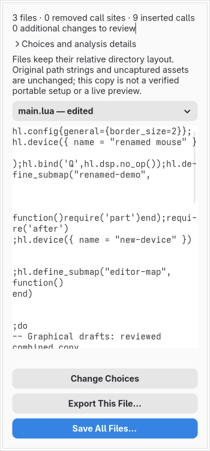

# Combined multi-file project copies

For a captured source graph, **Review Source Copy** opens **Combined Project Copy**. This connects the separate scalar, monitor, device, binding/submap, workspace-rule, window/layer-rule, curve/animation, gesture and session drafts to one review of all materialized source files. Current private source edits are the starting point, including retained private module inputs. The original capture tree is never reopened.

Each group has an explicit choice:

| Choice | Result |
| --- | --- |
| Keep source edits | Retain current private source bytes for this group; omit its separate graphical draft. |
| Append graphical draft | Retain existing calls and add the complete draft near the end of the root file, before its final return. Registration ordering follows the generated block. |
| Replace reached calls with draft | Remove known reached standalone calls of this group throughout the captured files, then append its draft at the root. An empty draft explicitly removes those calls. Unreached code is retained. |

Session drafts include environment, startup commands and permission rules. Replacement also refuses unrepresented session/event callbacks, so it cannot silently remove a separate window-event handler. Defaults keep every source group. They do not infer a deletion from an empty draft or assume that a root-file import represents declarations in other modules. Review the selected modes and file contents before export. Replacement relocates registration calls to the root; it does not preserve arbitrary inter-family ordering or certify equivalent runtime behavior.

The restricted worker validates the workspace and graph, materializes private revisions and inputs, checks that private inputs were reached, and freshly replays the captured program. It serializes typed drafts using the existing family codecs. Replacement requires complete captured replay and exact standalone call sites; consumed calls, a different retained group inside a removed container, and module loads inside removed calls are refused. A pure static submap may be removed with its reached children; a module-loading submap must be edited separately or kept/appended. Comments survive token removal, other bytes and module returns are retained, and loader coordinates are rebased.

All patches are reviewed together against fresh before/after observations. Every inserted call must be reached and every requested structural intention matched. Additional observation findings are displayed, including changes to arguments, scope, loader behavior or partial modeling. The review does not grant live-write authority or establish runtime equivalence. Existing 32-document, 1 MiB-per-file, 4 MiB source/worker-envelope, 256 structural-intention and worker resource bounds remain enforced; an oversized review reports an error instead of silently dropping data.

**Save All Files…** asks for a local parent folder and an unused child-folder name. It preserves the relative layout beneath the captured filenames' common parent. The parent process rechecks count, size, hashes and path conflicts; only then does it create a new 0700 directory and 0600 files. Held directory descriptors, no-follow opens and exclusive creation prevent replacement of existing files or symlink destinations. File contents are synced before success is reported. A failed write reports that a partial new directory may remain; it never cleans up or overwrites an existing tree. **Export This File…** remains available for a separate file copy.

A folder copy does not rewrite absolute paths, home paths, custom package paths, working-directory assumptions or references to uncaptured assets. It is not a verified portable configuration and must not be advertised as isolated compositor preview. Duplicate or unrepresentable load-view filenames can prevent folder output; per-file review remains available. Full safe relocation, effective-state discovery, dynamic Lua support, guarded apply/recovery and complete audit acceptance remain unfinished.

The review/export operation leaves graphical drafts, private revisions, saved-generation tracking and undo unchanged. New review work is discarded if the project changes during preparation. There is no idle worker, compositor process or desktop mutation.

Validation covers both audited snapshots; all nine groups in a multi-file graph; comment/CRLF and module-return retention; unchanged private source bytes under keep; append without removal; explicit empty replacement; adjacent insertion/removal coordinates; mixed/consumed/loader/partial refusals; and a shadowed root that cannot reach the generated calls. Folder tests compare complete bytes and permissions, refuse existing files/directories/symlinks and reject malformed hashes, names and file/directory collisions before publication. The private graphical fixture invokes the actual product action after capture originals have been deleted, reviews keep and append choices, compares displayed bytes with the worker result, exports the tree, checks draft-generation stability and exercises the save dialog.

The current 94-input source-model pin includes session declarations and their codecs. The reviewed transition preserves captured inputs and compiler observations; all 26 previous pinned models still require explicit rebuild review and a new project save. This is a bounded editing/export increment, not a completion certificate for the full project.
