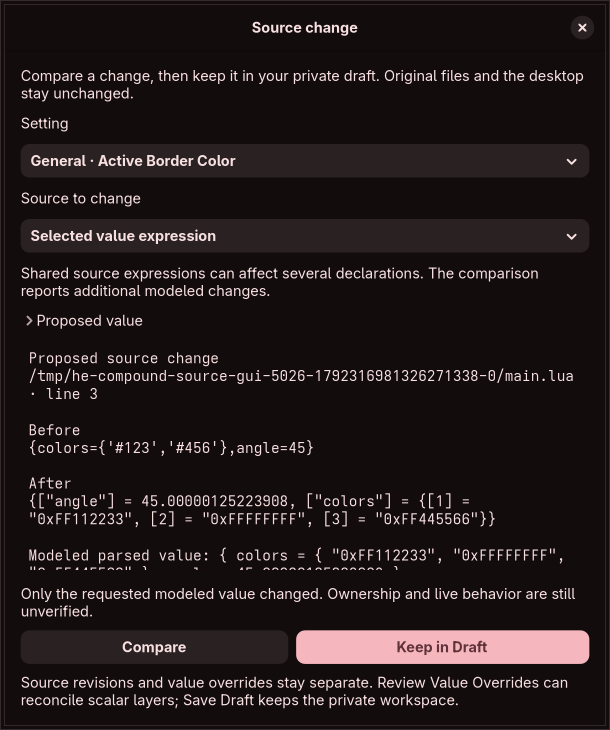

# Complex scalar values and typed source editing

The captured-source model now has parser descriptors for all nine scalar families in both audited snapshots. Color, Gradient, Vec2, CssGap and FontWeight join Bool, Int, Float and String. Source analysis shows their primary parsed values; supported finite representations can be compared, kept in the private source graph and reconciled with overrides. Original files and live settings remain untouched.

## Source-derived behavior

The [reference manifest](../data/complex-scalar-sources.json) pins 38 Hyprland/dependency files, including both snapshots' five parsers/headers, primary color conversion, type aliases, numeric/string helpers and locked dependency identities. Both snapshots have identical parser bodies for these five types. Their factories differ: baseline drops vector validators; audited-main forwards them. The registration probe now runs all nine original Lua constructors and observes active vector callbacks, keeping complex generic defaults and derived caches explicitly unmodeled.

| Family | Modeled primary value and important distinctions |
| --- | --- |
| Color | ARGB32 after original parsing and primary color conversion. Hex, decimal, hash, rgb and rgba forms keep their actual argument rules; rgba numeric alpha is not silently clamped. |
| Gradient | Ordered ARGB colors and binary32 radians. Input angles are degrees; the model preserves stored angle bits and converts explicitly for editable display. |
| Vec2 | Two binary32 coordinates. Positional arrays and native string parsing differ from named-only getter fields; only the exact version's forwarded validator applies. |
| CssGap | Four signed int64 sides. Scalar numbers use a binary64 cast; explicit fields use Lua's exact integer conversion. Missing fields become zero without checking bounds; explicit fields are checked. |
| FontWeight | Nonnegative int64 primary storage. Numeric strings enter the numeric path, fractions truncate, and recognized ASCII names use the pinned name map. This corrects the blueprint's earlier quoted-number claim. |

Nonfinite/out-of-range floating-to-integer casts and unsafe/unprofiled ctype inputs are unresolved rather than assigned invented native outcomes. Vector/gradient nonfinite storage stays distinct from finite editor representation. Dense positive-integer arrays establish one Lua table border; sparse arrays require VM layout/history absent from a value snapshot. The model therefore refuses to guess their raw length, even when a reconstructed table happens to produce an answer.

The editor-owned C++ text bridge uses the profiled libstdc++ conversions. Its immutable build identity is recorded separately from execution context. Decoding requires classic C++ locale, C/POSIX ctype, the existing C numeric locale and nearest rounding. Unsupported contexts remain unresolved. Original Hyprland source is fetched only for reference checks; its implementation is not embedded in the application. Derived color-space caches, setters, refresh effects, actual target dependency ABI and renderer behavior remain unverified.

## Controls, comparison and persistence

Source controls use a color chooser, exact numeric components, signed gaps and wide font weights. The gradient control keeps one swatch plus a searchable stop selector, add/remove/reorder actions and an exact angle field. Selecting a stop changes the view only. Changing data invalidates an existing proposal. The selector's model updates are separate from selection display to avoid a notification loop.

Compare independently rebuilds the registered model in the restricted worker, emits a bounded canonical literal and compares all other modeled observations. Tables use the evaluator's canonical key order; floating literals preserve their kind and signed zero, and the minimum int64 has an exact Lua expression. The preview includes the modeled parsed result so native numeric conversion is visible. Value controls fold after comparison to make room for review. Reopen Proposed value to edit.

Compound replacement covers the **selected value expression**, including comments and extra fields inside it; that consequence is explicit in the preview. This does not certify per-component ownership or lossless field insertion/deletion. Original snapshots remain available. Keep/save/reopen and combined source/override undo use the existing guarded private revision mechanism, with no writer or live capability.

Font weights use nonnegative int64 draft storage, extending the former uint16 range without changing older numeric encodings. Gap controls preserve signed int64 values instead of clamping to an artificial 0–100000 range. JSON decoding now enables binary64 round-trip accuracy after a deterministic test demonstrated a one-bit transport error. Ordinary scalar form/native-constraint integration is still incomplete outside these focused controls.

The current gradient editor retains its 32-stop representation bound. Larger parsed gradients remain intact and visibly unavailable for editing rather than being truncated. Existing document, table, worker, data and history limits remain enforced; full accepted-domain GUI coverage and whole-process memory acceptance remain required.

## Evidence and remaining scope

The original five parsers supply **1064 independent observations** across both snapshots, covering every normalized color channel byte, all weight names, conversions, malformed input, fractional gaps, signed zero, array shapes and explicit fixture validators. The core models compare against those outcomes; sparse-layout cases stay explicit unknowns. The actual factory callbacks add 102 vector-validator observations. All four pinned Lua releases rerun the reference corpus along with the existing ordered/path/primitive checks and conversion bridge.

Core source tests exercise every family in both versions, native constraints, canonical literals, immutable originals and source/override reconciliation. The graphical workflow edits and keeps all five types, verifies exact controls and selection-only behavior, saves/reopens after deleting the original fixture file, checks shared captures, undoes all five changes and inspects the rendered dialog. A deterministic 10000-value test checks exact finite binary64 transport. Undefined casts, forged/ambiguous tables and representation limits have separate checks.

This increment does not complete complex defaults/derived caches, all accepted-domain controls, metatable/library effects, complete source language/APIs, compound trivia ownership, external multi-file merge, generated configurations, persistent history or full source export. Effective discovery, isolated compositor preview, guarded apply/independent recovery, hardware/resource/accessibility/localization/packaging and every original security/release gate remain required. No full contract or overall completion percentage is certified.
