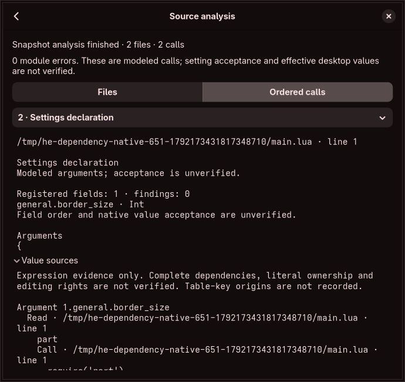

# Configuration table inspection

The [registration-aware worker](registration-aware-inspection.md) now adds per-value models and the bootstrap key to captured calls; actual runtime acceptance and ownership remain unverified.

Captured `hl.config` calls now have registry-dispatch evidence in graphical call details and diagnostic `configuration_tables` output. This connects immutable evaluated arguments to version-scoped setting IDs. Editable graph drafts and native value acceptance remain unfinished.

## Independent source observations

`scripts/config_table_probe.py` verifies full file hashes recorded for `api:hl.config` in the implementation contracts. It compiles the unmodified handler from each audited snapshot against real Lua C-API tables and inert registry, parser, refresh and location adapters. The 52 observations cover nested/dotted keys, ignored non-string keys, known table-valued settings, unknown categories, empty keys, extra arguments, NUL aliases/collisions, raw iteration ignoring `__pairs`, nil removal and parse-failure continuation. The deliberate adapter failure observes continuation only; it is not a native setting codec. Sources/builds exist only in automatically removed temporary directories.

The handler uses raw `lua_next`, handles string keys only and constructs C++ strings through the first NUL. It joins nested nonempty prefixes with a dot, checks registry membership before recursion and delegates a known setting's whole value to its parser. Unknown table keys are recursively visited. Lua table order is not a portable source order. References and editor compare delegation multisets. Candidates sharing one setting ID within a call are all ambiguous; no winning value is inferred. Repeated API calls retain the evaluator's execution order.

## Evidence and bounds

`lua::config_table::inspect` retains setting IDs, registry keys/kinds, argument/value-row coordinates, raw untruncated key segments and optional expression IDs. Coordinates borrow values from the caller's immutable event. Matching order/API is a shape guard, not a freshness, ownership or editing capability. The coordinator binds these records to its immutable program/report. Key origins and full consumer-impact analysis remain open.

Traversal permits 32 levels, 8,192 visits, 2,048 candidates and 2,048 findings. Canonical paths permit 4 KiB and raw path segments 64 KiB. Encoded candidate/finding data permits 512 KiB per call. Batches also share the coordinator's estimated 8 MiB retained-data and cooperative ten-second limits. These are logical bounds, not process-memory certificates. Unknown shared/cyclic observations remain unresolved; native cyclic traversal is not attempted. Budget failure retains earlier batches and marks partial results. An unresolved table also prevents `model_completed` even if expression evaluation finished.

The existing call-details pane displays up to 32 fields and 16 findings with explicit clipping. No new folder access, source fetch, VM execution, draft mutation or writer is enabled. Native acceptance and within-call order remain unverified. The single-root static importer now also applies NUL truncation before registry lookup, preserves key spelling in prepared copies and refuses ambiguous same-call targets.

## Verification and remaining scope

Core tests compare delegated keys and value signatures with all 52 independent observations across both snapshots. They verify NUL retention, collisions, cycle/path limits and separate expression evidence. Actual helper tests verify recognized imported values, collisions, cyclic partial results and budget refusal without changing sources. The private-display native workflow verifies a displayed registered field, imported expression evidence, unchanged draft generation and 350-pixel minimum width.

Native scalar/structured codecs, full API handlers, key/control/write/ownership graphs, editable multi-file import, schema-pinned persistence/history, reconciliation and lossless source edits remain required. Effective discovery, isolated preview, guarded apply/recovery and all original resource/security/release gates remain unchanged. No full contract or completion percentage is certified.

