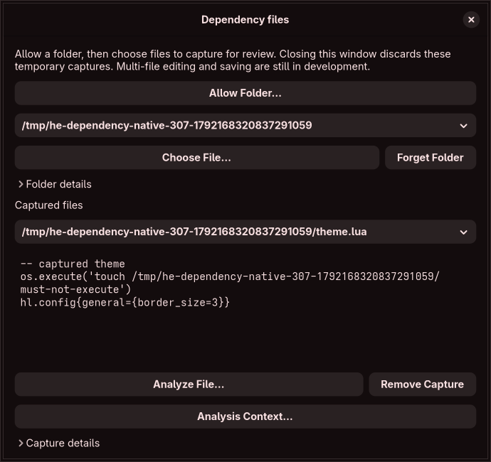

# Approved dependency captures

**Inspect Source Modules → Review Dependency Files** opens a focused native window for temporary source review. Choose **Allow Folder**, then **Choose File** within the selected allowed folder. The source snapshot, path/hash evidence and folder evidence can be inspected without running Lua, changing a draft or writing a configuration. Technical evidence stays collapsed. This is a capture/review workflow; it does not yet import or evaluate a multi-file configuration.

The window supports several explicitly selected folders, a selected captured-file view, **Forget Folder** for future reads, and **Remove Capture**. Reapproving the same selected location replaces its live access handle. Already captured bytes remain immutable after a source edit or forgotten folder; retaining those bytes retains no folder authority. Closing the window discards the session's captures and grants. A read already in progress can retain its helper/handle until completion or timeout cleanup. There is no persistent permission, automatic source reload or watched-folder service.

## Live authority and capture

`source_scope::Identity` records selected/resolved byte paths, device, inode, mount ID, UID/GID, mode and symlink evidence. This serializable record cannot confer authority. `directory_worker::Grant` additionally holds a live O_PATH directory descriptor in the application. The approval helper resolves only an explicitly selected folder, checks link evidence, probes the exact containment flags and descriptor mount-identity support, and transfers the held descriptor over a private Unix stream using SCM_RIGHTS. It then exits. Grant records are not restored from saved workspaces or parser suggestions.

Each file capture sends the descriptor into a fresh helper, which verifies directory type, O_PATH status, device/inode/mount/UID/GID/mode and a live link count. Filesystem metadata operations remain in that process; the parent only validates returned data and source identity/hash. Directory entry changes do not revoke the grant by themselves. Ownership/mode/mount changes or an unlinked directory require a new selection. These checks do not constitute complete ACL, generator or ownership detection.

Contained paths are resolved through the held root with openat2 BENEATH, NO_MAGICLINKS, NO_XDEV and NO_SYMLINKS. Repeated root-relative opens refuse implicit intermediate symlink following, including raced replacements. No-follow O_PATH nodes allow bounded ordinary symlink inspection without opening source bytes. Relative and absolute links inside the approved scope are supported; absolute aliases must still refer to the approved device/inode/mount. A retained folder may move, but it cannot silently reinterpret an absolute source reference to a replacement folder. Outside targets, mount crossings, unknown aliases and paths leaving then reentering the root require separately reviewed access. Relative path components are checked in order; lexical cleanup is not containment. Limits remain 32 symlinks, 4,096 path bytes/steps and a regular UTF-8 source of at most 1 MiB.

After resolving a contained leaf, Landlock grants READ_FILE to that held regular inode only, then a dedicated seccomp policy permits capture and replies on the existing private channel. The folder approval role permits replies without filesystem opens. Neither role can create/connect sockets, start processes, execute programs or mutate filesystem entries. Landlock also rejects writable/creating/truncating opens. Captured file/link consistency and root identity are rechecked before returning bytes. The parser remains a separate worker with no filesystem opens.

## Metadata observations for loader resolution

The new `--probe-source-folder FOLDER CANDIDATE` diagnostic uses the same live folder grant and bounded helper to observe metadata without reading source content. It supports files, directories, FIFOs and byte-oriented names; a present regular file does not prove read access. It returns typed observations: present node metadata or an ENOENT/ENOTDIR absence observed during contained traversal. Permission failures, escaped paths/mounts, replaced absolute aliases, changed root authority, link changes, unavailable containment, budgets and I/O uncertainty are distinct blocking failures. Transport, isolation and invalid-grant failures remain outer errors and cannot be converted into absence. The reply records no effective runtime verification.

The helper retains encountered symlinks and rechecks them and the approved root before returning a positive or negative observation. Only metadata is inspected; the reply role denies further opens and never captures nonregular node content. Private tests cover unreadable/non-UTF-8 files, FIFO/directory nodes, broken links, denied lookup, cycles, implicit intermediate links, renamed/replaced roots, changed links and unavailable isolation. These are point observations, not an atomic directory snapshot, read-permission certificate or proof of loader precedence. No metadata outcome alone constructs an evaluator binding. Raw status paths and normalized load filenames may refer to different inodes and still require separate evidence before integration.

This design uses the documented [openat2 containment rules](https://man7.org/linux/man-pages/man2/openat2.2.html), [descriptor mount identity](https://man7.org/linux/man-pages/man2/statx.2.html), [ancillary message handling](https://man7.org/linux/man-pages/man3/cmsg.3.html) and [Landlock rules](https://docs.kernel.org/userspace-api/landlock.html). Ordinary mount IDs are paired with retained descriptors, not persisted as reusable capabilities. Actual concurrent mount/alias adversaries and all filesystem/kernel combinations are not certified by these fixtures.

## Bounds and lifecycle

The private channel accepts one marker-framed message and at most one descriptor per direction, receives descriptors with CLOEXEC, rejects malformed/truncated/extra-descriptor messages and closes received capabilities on failure. Folder requests/replies are capped at 2 MiB / 8 MiB. A single-flight lease is shared with selected-file capture; transport failures trigger immediate asynchronous cleanup, and the lease remains held until child/pipe cleanup finishes. The same three-second post-spawn response budget, resource limits, parent-death signal and kernel-uninterruptible-I/O caveats described in [selected-file capture](source-capture.md) apply. This does not establish hard FUSE/NFS teardown or a whole-program startup/I/O deadline.

The GUI permits eight folder grants, 32 captured revisions, 4 MiB cumulative source bytes and an estimated encoded-retention budget of 8 MiB. It counts folder evidence conservatively and includes source-escaping amplification. Validation and encoded-size counting run off the GUI thread; counting does not allocate another serialized source buffer. Only the selected capture renders, with at most 16 KiB of source shown, preserving line breaks and escaping control/bidi characters. Complete source bytes stay in bounded session records until removed. These are logical-data bounds, not a whole-process memory certificate or the blueprint's 100 MiB PSS acceptance.

Version, root source hash, draft generation and operation epoch bind results to the requesting session. Changed drafts reject late results and clear their access/data; closed windows release stored grants/snapshots and ignore pending completions. The controls retain weak window/state references. Forgetting a folder affects future captures; already running kernel I/O may outlive a close/kill request and remains under the single-flight quarantine limit.

## Evidence and required continuation

Private core fixtures cover internal absolute/relative aliases, non-UTF-8 paths, traversal/prefix confusion, cycles, FIFOs, retained-root rename/replacement, forged inode/mount identity and mode changes. Real application/helper fixtures verify repeated descriptor transfers, CLOEXEC, missing live-descriptor refusal, permission revocation and release. Actual CLI tests cover inert source/hash observations, external targets and inherited child-only simulation of unavailable openat2/Landlock APIs; unavailable support fails without a fallback. Channel tests cover size, marker and multiple/truncated-descriptor refusal.

The native workflow checks approval/capture, reapproval, unchanged draft generation, immutable bytes, forgotten authority with retained snapshots, capture removal, stale-generation rejection, measured 350-pixel minimum width and closing during work with eventual grant/model release. The actual rendered window is inspected separately. File picker portal behavior, screen readers, translated/large-text layouts, remote I/O, malicious concurrent mounts and whole-app failure/resource scenarios remain unproven.

Local Linux x86-64 validation passed 188 ordinary tests and the private-display native workflow (189 total), formatting, strict Clippy, a release build and metadata/register consistency. The screenshot uses synthetic files and was visually inspected. A capture fixture waits for a real GTK render node after model changes; allocation alone does not establish that a frame is ready. This evidence does not certify minimum-kernel, aarch64, distro/driver or remote-filesystem compatibility.

Still required: complete ownership/alias/mount review, bounded wildcard enumeration and miss/cycle evidence, integration of captured evidence with ordered evaluation and actual loader precedence, complete graph diagnostics, schema-pinned graph save/reopen/history, multi-file reconciliation, lossless insertion/deletion and legacy source codecs. Capturing a candidate is not proof that Hyprland loads it. Source-ordered syntactic sites are not execution order. Effective discovery, isolated compositor preview, independent recovery, guarded apply and every remaining original audit obligation remain in scope. No full contract or feature-completion percentage is certified by this increment.
