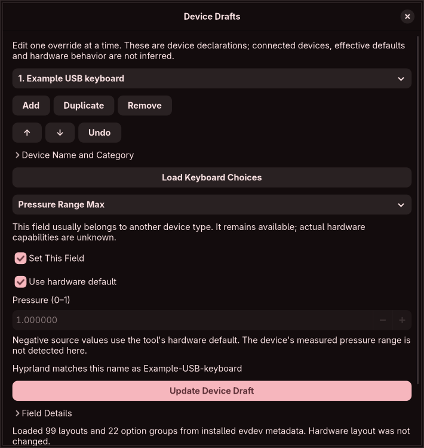

# Device draft editor

The [registration cross-check](registration-aware-inspection.md#scope-corrections-remain-mandatory) found four additional tablet-tool value fields beyond this original 43-field register. Those fields now have private draft controls, static Lua import/export and save/reopen coverage. Version-correct native semantics, effective device discovery and activation remain unfinished; this document does not establish complete device behavior.

Open **Menu → Edit Devices**. The editor covers 47 writable device fields (43 original fields plus four source-discovered additions) plus the required name selector in both pinned Hyprland snapshots. The reproducible catalogue generator checks the original 86 version records; the source registration generator supplies eight additional records, bringing the total to 94 across both snapshots. Registered fields and runtime-observable properties remain separate; the additional read-only device properties in the blueprint are not presented as editable settings.

Add a rule, expand Device Name and Category, enter a Hyprland device name and choose an optional category hint. Hyprland replaces spaces in device names with hyphens; the source spelling is preserved and its normalized name is reported. Categories explain usual field relevance while keeping all fields visible. They do not establish actual connected-device capabilities. Repeated declarations for the same normalized name stay ordered, reflecting upstream field replacement; this editor does not infer effective state from them.

Choose one field, enable Set This Field and Update Device Draft. Disabling the field and updating removes its override; explicit false, zero and empty values remain distinct from absence. Rules support add, duplicate, reorder, remove and shared bounded undo. Save Draft persists device/scalar/monitor drafts and any source snapshot in the private workspace. Devices have their own catalogue hash covering both the original fields and additions. The exact original schema hash is accepted only for its original field subset, without inserting new overrides or reopening recorded source paths. Unknown hashes and new fields under the old hash are rejected. A new save uses the extended schema; older apps may reject that workspace.

| Area | Current controls |
| --- | --- |
| Keyboard | Layouts/variants, model and option groups from installed XKB metadata; rules/keymap identifiers; repeat delay/rate, Num Lock, bind resolution, state sharing and release behavior |
| Pointer/touchpad | Sensitivity, acceleration choices/custom numeric curves, scroll method/factor/button/lock/custom points, handedness, rotation, tapping, dragging, middle-button emulation, natural scroll and flips |
| Tablet/touch | Region and active-area position/size, relative/absolute modes, output name, transforms, eraser behavior/button choices and pressure range |
| Common | Enabled/keybinds switches, tag rows with automatic delimiter escaping, source provenance and category relevance explanations |

**Load Keyboard Choices** reads the fixed `/usr/share/X11/xkb/rules/evdev.xml` package-metadata path. It rebuilds controls from the staged draft, so update an edited field before loading. The bounded file read inspects a regular node; XML parsing runs in the existing restricted child, without resolving the referenced `xkb.dtd` or any custom/external entity. Missing or incompatible registries report an error and preserve editable identifiers. Registry data describes installed choices, not the active compositor layout or proof that a custom keymap compiles.

Layout and variant slots are edited as linked ordered pairs; changing a layout selects its default variant. Updating either paired field stages both values together. Removing a field only removes that specific override. Option groups honor single/multiple-selection metadata; unknown existing option identifiers remain explicit selectable entries. Model/layout/variant choices retain identifiers missing from the installed registry rather than silently selecting another one. Keyboard options are built lazily when a group is opened; closing the group releases its controls while retaining the selected values. At most 16 layout slots and 128 tag rows are exposed by this initial UI. Larger imported lists remain saved and the graphical builder refuses to stage a truncated value; XKB/runtime compatibility and exact group limits remain unverified.

Custom acceleration and scroll points have a numeric input-speed step and ordered pointer-speed values. The editor validates a positive finite step and 2–64 finite nonnegative points. This is an editor policy, not a claim that all curves are useful or accepted by every libinput/device combination. Scroll points only take effect with custom acceleration; unknown inherited acceleration produces a finding. There is no physical response preview. Drag-lock and three/four-finger choices follow the libinput enum values inspected during implementation; state-sharing modes retain their exact numeric values without inventing device-specific behavior.

Region coordinates are finite pairs; sizes cannot be negative and zero preserves the upstream automatic-area convention. Device physical dimensions, output binding, coordinate-unit interoperability and region interactions are not certified. Input transform values outside the usual -1..7 range are preserved in the numeric form and explain the handler's clamp behavior. Keymap selection stores a path reference; the file is neither read nor compiled. A nonempty keymap reference explains its precedence over layout/model/options.

Tablet pressure controls offer **Use hardware default** or a value from 0 to 1. An imported negative sentinel remains unchanged until the user changes that control; selecting hardware default explicitly stores -1. Eraser controls expose described modes 0/1, other declared numeric modes, stable Linux button names and a custom numeric code. They do not read input events or detect hardware. Numeric bounds are the declared editor policy; the older native Lua registration drops some validation, so these bounds are not a certificate of all native acceptance. Full numeric-domain editing and cross-field/hardware semantics remain required.

Static top-level `hl.device` literal tables and supported pure local expressions can be imported without executing Lua. Ordered declarations and explicit fields are retained. Unknown/invalid fields, duplicate constructor keys, opaque expressions and control flow produce diagnostics and remain in the source snapshot. Import is not an effective-state reader. Legacy device blocks are not imported yet. Reviewed Lua export combines scalar, monitor and device overrides; copying does not apply them and the fragment must not replace a complete configuration.

Device source-span updates/insertion/deletion and changed-source reconciliation remain unimplemented. Existing source comparison merges scalar settings and retains monitor/device drafts unchanged; it explains this limitation. Scalar source-copy export is blocked if it would omit a device draft change.

Hardware discovery, real capability records, global/default provenance merging, XKB compilation/visual keymap preview, tag propagation into bind filters, last-input recovery planning, live apply, source codecs and isolated routing tests remain mandatory work in the original blueprint. This milestone does not certify complete device behavior or close the full DEVICE contracts.

Ordinary text controls now preserve the core’s accepted 16 KiB ASCII boundary instead of shortening imported values at 4,096 characters. GUI checks also exercise this boundary and refusal to truncate oversized layout/tag lists. Tag delimiter/backslash fixtures were compared with the installed hyprutils 0.14.2 parser; this is narrow codec evidence, not a device activation certificate.
