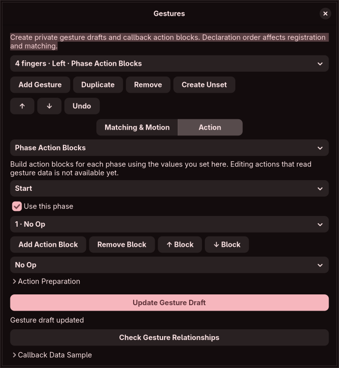

# Gesture draft editor

The 0.12 editor authors ordered private `hl.gesture` declarations for the two pinned Hyprland snapshots. It supplies controls for all nine declaration fields, three callback phases and exact unset identity. These are partial feature foundations; none of the thirteen full GESTURE contracts is certified.

## Controls and registration

The selected form separates matching/motion from actions. Finger counts are Lua integers from 2 to 9. Direction choices cover swipe, horizontal/vertical, individual directions, pinch and individual pinch directions. Eight modifier switches represent the exact mask. Untouched imported direction aliases, modifier spellings, coercible scalar representations and optional fields are retained. Numeric-string and non-ASCII coercion outside the modeled domain remains unresolved source.

Motion has an optional multiplier, slider and exact entry. The baseline checks raw numbers against its float32 lower bound: literal `0.1` is below `0.1F` and rejected. The newer snapshot allows negative multipliers, checks raw -10..10, then requires float32 magnitude at least 0.1. Its inversion control is available only there. Inhibition override and optional mode, zoom level and workspace name are retained independently of the chosen action. Built-in choices cover workspace, resize, move, special, close, float, fullscreen, cursor zoom, scroll movement and unset; the cursor zoom alias is preserved.

Add, duplicate, remove, reorder, undo and create unset declarations. Registration findings simulate an initially empty registry in declaration order. An earlier broad direction can block a later specific direction; the reverse order can register and partially shadow a broad gesture. Scale and inhibition do not distinguish overlapping registrations. Unset matches fingers, normalized direction, modifier mask, float32 multiplier and inhibition override, removing the first exact match. It does not mean merely removing any gesture with the same fingers/direction. External includes and runtime changes can alter these relationships; findings are not effective-state discovery.

## Callback blocks and inert samples

Create start/update/finish phase blocks or a legacy finish callback. Each phase supports up to 64 known dispatcher action blocks, ordering, removal and existing constructor-specific controls. An explicitly present empty phase remains a function. Prepared actions are constructed when configuration loads; delayed constructors remain inside their phase. Unused optional callback parameter names survive export, and generated captured-action names avoid shadowing them. Legacy callbacks receive no event arguments.

Callback data samples display finite synthetic JSON. Start/update contain phase/type/direction/time/fingers/delta; pinch adds scale/rotation. Finish uses phase `end` and includes cancellation but omits fingers/delta/scale/rotation. The registration table key is `finish`; `end` is not a recognized key. Samples do not execute a callback, route real input or show compositor effects. Actual routing has thresholds, inhibition checks, ordered matching and potentially different start/update/finish directions; these are not certified by the payload builder.

Only literal functions containing known static dispatch blocks are projected. Conditions, loops, reads of event data, arbitrary calls, return values, dynamic captures and general workflow expressions remain preserved opaque source. Creating an opaque function does not itself execute its body or taint later independent declarations. Evaluating an unknown expression while constructing arguments does. The complete workflow editor remains required by the original audit.

## Storage, boundaries and evidence

Static import never runs Lua. Gesture drafts participate in per-version state, dirty checks, generation handling, bounded history, ordered export and `.hye` schema pins. Reopening reparses saved bytes in the restricted parser without opening recorded original paths. Saving during newer edits cannot mark them saved. Scalar source-copy export refuses changed gesture drafts rather than silently dropping them. Source insertion/deletion and gesture reconciliation are still required.

Limits are 1,024 declarations, 1 MiB serialized draft, 16 KiB per text field and 64 actions per callback phase. Shared parser, workspace and retained-history budgets also apply. Only the selected declaration/phase/action form is built. There is no idle frame loop, command execution, touchpad injection or compositor mutation. Closed-editor state release is checked by the private-display fixture; full memory/CPU certification remains open.

`data/gesture-semantics.json` pins source SHA-256 and Git blob identities. `scripts/gesture_source_probe.py --check` compiles actual binding, integer/float/bool/string descriptors, direction/modifier parsers, add/remove registry and callback payload functions against 144 stored observations. It uses real Lua 5.4 with inert built-in actions, fake dispatcher/VM services, base-distance and pointer-ownership adapters. It directly invokes callback interfaces; it does not compile the manager input routing, renderer, callback timeout guard or userdata ABI. JSON keys are sorted because Lua table iteration order is intentionally unspecified.

Core tests compare registration, float32 boundaries, callback fields and constructor timing with those independent observations. Additional cases cover every built-in/direction alias, all five unset identity fields, reserved parameter/captured-name shadowing, opaque function boundaries, export/import and storage limits. Application checks cover edited callbacks reopening with deleted originals and refusal of schema/shape tampering. Native checks cover CRUD/order/undo, invalid-input navigation/close guards, phase presence, action blocks, both scale versions, unchanged imported spellings, private saving and released draft state.

The animation source probe error adapter was also corrected: upstream `configError` records errors and returns zero, allowing later declarations to run. The adapter now follows that behavior; all 170 existing animation observations remain unchanged.

## Remaining full scope

Complete Lua/string/numeric codecs, richer GUI parameter builders, general event-dependent workflows, source ownership/insertion/deletion/reconciliation, registration lifecycle and effective discovery, real input routing/inhibition/cancellation, callback resource enforcement, compositor conformance, isolated preview, guarded apply/recovery, accessibility, localization and repeatable resource/release certification remain required. Built-in renderer behavior is not established by constructor adapters. No gesture or other full feature contract is marked complete here.
