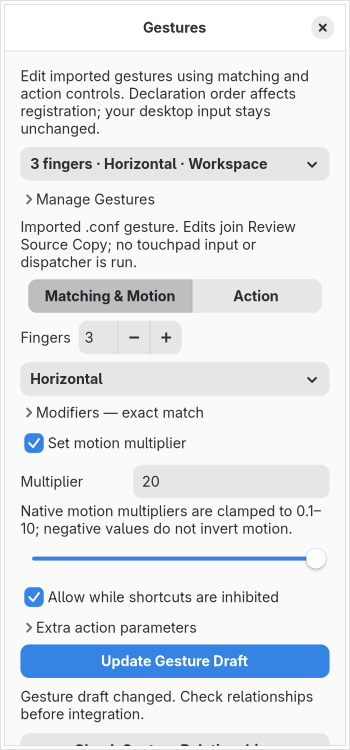

# Gesture editing

Use **Edit Gestures** to select a declaration, then switch between **Matching & Motion** and **Action**. Manage Gestures contains add, duplicate, remove, reorder, create-unset and undo controls. Only the selected declaration/action form is built. Editing never injects touchpad input, runs a dispatcher or changes the running compositor.

## Existing `.conf` gestures

Literal top-level `gesture` declarations and declarations in a flat `gestures` category populate these controls. The `gesturep` flag maps to **Allow while shortcuts are inhibited**. Direction aliases and modifier spellings survive unchanged edits. Repeated `mod:` and `scale:` prefixes use their last value, matching the native handler.

Native motion multipliers are clamped to float32 0.1–10 for registration. A negative multiplier does not invert native motion. The raw finite normal input remains in the draft and source review; the displayed hint distinguishes it from the clamped effect. Native cursor zoom takes zoom level first, then mode. The shared scroll-movement action emits native `scrollMove` spelling. Common mode choices cover float/tile, fullscreen/maximize and zoom multiply/live/toggle; ignored parameters remain private draft data when switching action types.

**Run Native Dispatcher** offers all 71 audited baseline dispatcher names with common argument presets, plus a custom name for retained plugin/unknown dispatchers. Dispatcher arguments remain plain text, including representable commas and spaces. The editor never invokes them. Native dispatcher gestures run at finish in Hyprland; they are not silently converted into Lua callbacks. Callback phase builders remain separate for Lua drafts.

**Review Source Copy** includes native gesture edits alongside scalars, session directives, monitors, bindings, workspace rules and animations. Untouched statements, comments, unresolved lines and line endings remain. Changed statements use canonical native flags/prefixes and escaping, then the complete supported projection is reparsed. Some numeric aliases, unknown flags, variable/expression/include uses, qualified or other-category placements and unrepresentable escaping remain retained/unresolved.

Private projects retain captured-source/codec markers even for a deliberately empty gesture target. Older projects rebuild recognized source gestures and append older separate Lua drafts with distinct identities. Reopening does not access original paths or change old files. Native and Lua registration simulations remain separate. Ordinary preview preparation records native omissions without dispatcher, argument, modifier or workspace payloads. Actual isolated compositor preview is still unfinished.

## Registration and Lua drafts

Finger controls cover 2–9. Directions cover swipe, horizontal/vertical, individual swipe directions, pinch and individual pinch directions. Eight modifier switches represent exact mask bits. An earlier broad direction can block a later specific direction; a later broad direction can partially shadow earlier specific registrations. Scale and inhibition do not distinguish overlap, while unset requires the full identity: fingers, normalized direction, modifier mask, float32 scale and inhibition flag. Findings start from an empty private registry and do not discover actual runtime state.

Lua drafts retain all nine declaration fields and built-in actions, three callback phases and legacy finish callbacks. Their pinned scale rules differ from the native clamp: the baseline uses its raw float32 lower bound, while the newer audited snapshot supports bounded negative multipliers. Optional fields, false values, direction aliases and supported coercible representations remain distinct in private projects.

Callback phases support up to 64 known action blocks, ordering and removal. Explicit empty phases remain functions. Prepared versus delayed construction stays distinct, optional parameter names survive export and generated names avoid collisions. Synthetic callback data is inert JSON; it does not execute callbacks or certify input routing, cancellation, timing or renderer behavior. General conditions, loops, reads of event data, arbitrary calls and dynamic workflows remain opaque source and require the full workflow editor.

## Storage and verification limits

Limits remain 1,024 declarations, 1 MiB serialized draft and 16 KiB per text field, alongside existing workspace/worker/history budgets. Source parsing uses restricted workers. Saved projects pin source/model identities and retain original-free save/reopen, dirty tracking and undo. No resident polling or animation loop is added.

`data/legacy-gestures.json` pins the native handler, direction/registration, dispatcher, cursor-zoom and argument-splitter sources. The separate `data/gesture-semantics.json` and `scripts/gesture_source_probe.py --check` retain the earlier Lua reference observations; this editing increment does not claim a fresh compiler matrix or full native/hardware verification. All thirteen full GESTURE contracts, effective discovery, real isolated preview, guarded apply/recovery and complete memory/accessibility/security/release acceptance remain required.
