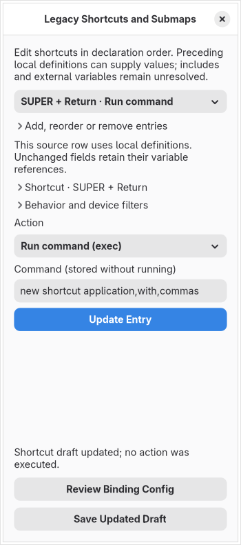

# Legacy shortcuts and submaps

Import a baseline `.conf` and open **Menu → Edit Bindings**. The legacy view edits ordered `bind…`, `submap` and `unbind` declarations. It preserves their native meaning rather than converting them to Lua callbacks. Choose an entry, change its controls and press **Update Entry**. **Save Updated Draft** saves the updated project; **Review Binding Config** prepares a binding-only fragment. The main **Review Source Copy** combines scalar, session, monitor and binding changes into a separate configuration copy.

Shortcut controls offer modifier switches, key symbols, keycodes, mouse buttons, wheel directions and switch events through the existing key picker. Focused recording uses only events delivered to the editor, stops on blur/unmap or after ten seconds, and never reads `/dev/input` or installs a global hook. Multi-key mode has separate item lists for XKB modifier and key symbols, up to eight of each. The behavior section includes all 14 ordinary suffix flags; multi-key mode, description presence and device-filter presence supply the remaining three suffix flags. Conflicting native combinations are refused.

All 71 dispatchers from the pinned baseline are selectable. Arguments remain exact text, including commas in a normal action's final argument. Common direction, mouse, power and submap actions offer explicit quick choices. General selector, coordinate and dispatcher-specific builders still need completion; selecting a dispatcher is not proof that every argument is valid for the running compositor. Commands are stored without execution. Mouse-drag bindings keep their distinct three-prefix-field form and require the mouse dispatcher.

Submap entries switch the scope of following declarations and can name an automatic reset target. **Global shortcuts / reset** returns following entries to the global scope. These are flat ordered switches, not nested Lua definitions. Catchall requires a preceding named submap. Specific unbind entries match a modifier/key pair across submaps; **Remove all previously registered shortcuts** preserves the distinct `unbind = all` operation. Open **Add, reorder or remove entries** for management controls. Adding, duplicating, removing, reordering and undoing use normal project history. Moving/removing a scope entry can affect following shortcuts; review the complete order before exporting.

The codec handles literal and supported source-derived top-level declarations in a selected-file model whose entry scope is global. It does not know whether another configuration includes this file inside an existing submap. Includes, unresolved dynamic directive names and unresolved submap switches make the following scope unknown until an explicit supported submap switch/reset. Bindings in that unknown scope stay unresolved. Unknown/external variable values, expressions, conditionals, continuations, nested declarations and unknown flags remain source text; the editor does not consult host environment variables or execute configuration commands. Known preceding definitions such as `$mainMod` now populate the controls; unchanged source fields keep references, duplicate/reorder carry source links, and moving across changing definitions requires explicit literal conversion. Older projects keep their literal-only view until a reviewed upgrade. See [local-variable editing](legacy-binding-variables.md).

Source copying preserves comments, Unicode, CRLF and untouched source spelling. Changed declaration slots are rebuilt; additional entries append at the end. The complete result is reparsed and compared with the requested ordered draft. A bounded digest also checks the original unresolved statements and their submap contexts. A copy that would change an unresolved statement's scope or append a binding after an unknown include without an explicit reset is refused. Keep the project and repair/review the scope instead. Inputs and draft projections are limited to 1 MiB and 10,000 entries; unresolved line details are capped at 4,096 without retaining an unbounded barrier list.

Saved projects retain captured source and codec identities, including deliberate removal of every supported binding. Reopening uses saved bytes even after the original is deleted. Older projects rebuild supported legacy declarations while retaining older separate Lua binding drafts for review. **Separate Lua Binding Drafts…** appears when those drafts exist; they are not silently converted or omitted from a whole source copy. Unsupported separate draft families still block combined legacy export.

Ordinary preview preparation omits these native operations and records payload-free unsupported entries. Command, device, description and submap values do not enter its Lua or fidelity report. This is not actual compositor preview. No shortcuts are installed, dispatcher invoked, executable looked up, live policy changed or configuration reloaded while editing. Full dynamic/include handling, effective-state discovery, actual preview, live apply/recovery, complete graphical action grammars and original security/resource/release gates remain required.

The exact baseline [legacy handlers](https://github.com/hyprwm/Hyprland/blob/efb50993780079460b0cbed1363e2166a2de1d9f/src/config/legacy/ConfigManager.cpp), [keybind manager](https://github.com/hyprwm/Hyprland/blob/efb50993780079460b0cbed1363e2166a2de1d9f/src/managers/KeybindManager.cpp) and [dispatcher translator](https://github.com/hyprwm/Hyprland/blob/efb50993780079460b0cbed1363e2166a2de1d9f/src/config/legacy/DispatcherTranslator.cpp) are content-pinned in `data/legacy-bindings.json`. No downloaded source repository is retained.
