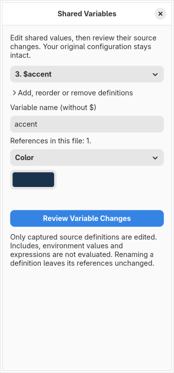

# Shared variables in native configuration

Import a `.conf` project and choose **Menu → Edit Shared Variables…**. The editor shows recognized top-level `$name = value` definitions in source order. Choose one definition and edit its name and value. Color, number, modifier-key and switch helpers complement **Text or reference**. Unchanged helpers retain the exact template spelling; selecting a different helper authors a replacement value.

Expand **Add, reorder or remove definitions** to add, duplicate, remove or move entries. New definitions follow the last recognized definition in the resulting source; if none exist, they are inserted at the beginning. Repeated names remain separate assignments. Their order matters: removing one can expose an earlier value. Renaming changes only that definition; references elsewhere are retained. This is not a project-wide rename operation.

**Review Variable Changes** prepares a proposal in restricted workers. It first materializes the supported scalar, session, monitor, binding, workspace, rule, animation, gesture and device draft edits into a separate source copy. It then edits the selected definition slots and reparses the resulting source. A shortcut field you explicitly changed remains a literal; unchanged references continue to use definitions. Known preceding local shortcut values follow the new definitions. General variable resolution in other editor families remains unfinished: their unsupported references remain source text, not invented typed values.

The review has **Impact**, **Before** and **Proposed** tabs. It reports definition/shortcut counts, unresolved source counts and resulting supported literal shortcuts. Other staged native edits are included. **Keep Editing** leaves the project unchanged. **Keep Private Changes** accepts the reviewed source revision and supported projections together. If any draft changes during preparation or review, the proposal is refused and must be prepared again. Unsupported separate Lua drafts or a source copy that cannot faithfully represent staged edits are refused with the current project retained.

Keeping a proposal changes the private draft. **Undo** restores the preceding source and all nine draft groups together, including source links and private metadata. Device category hints, explicit environment false/unset choices and equivalent typed declarations are retained. The undo operation is checked against the existing bounded history budget before any state changes. Large revisions can be refused when their inverse would exceed that budget.

Choose **Save Draft** or **Save Project As…** to retain the revision. The `.hye` file keeps both the immutable original source/identity and the edited native source, bound by a base hash and codec identity. Native projection markers bind the edited source. Reopening reparses saved bytes without opening the original path; the original file may be deleted. Older readers refuse the new revision field rather than silently dropping it. A completed older save cannot mark newer changes as saved. A variable-only revision remains dirty until its actual source revision is saved.

**Review Source Copy** uses the current private revision and includes subsequent supported draft edits. It offers a separate reviewed output through the existing new-file-only writer. Editing, review, project saving and undo do not publish configuration, reload Hyprland, execute commands or activate environment/policy settings. The private source review is not a compositor preview. Ordinary preview preparation omits native variable templates and source-revision text with payload-free fidelity records.

## Scope and bounds

Definitions use complete identifier names up to 256 bytes, with letters, digits and underscores. Raw single-line templates retain aliases, backslashes, expression text and native hash escaping. They are not evaluated by this editor. Continued, nested, conditional and unsupported-name definitions remain in the source and unresolved report. Unknown includes, ambient values, native prefix substitutions, expressions and full reference semantics remain unfinished. The reference display counts bounded complete-identifier occurrences; it does not prove runtime use or a safe global rename.

A source and a serialized definition draft are each bounded to 1 MiB, with at most 1,024 recognized definitions and 64 KiB per template. The text helper retains the full 64 KiB UTF-8 boundary. Oversized insertions are refused, and an oversized replacement restores the prior selected text. Invalid names/templates stay visible and block selection changes or review. Closing pending edits offers **Keep Editing** or **Discard Form Changes**. Removal intentionally discards the selected form. Only the selected definition's controls are resident; workers run on demand, with no polling or environment/include lookup.

The profile pins [hyprlang's parser](https://github.com/hyprwm/hyprlang/blob/090117506ddc3d7f26e650ff344d378c2ec329cc/src/config.cpp). Native variable RHS substitution/expression handling precedes assignment, and repeated names replace stored values; this editor preserves the source templates while resolving only its existing bounded shortcut subset. Research used in-memory reads, without retaining an upstream repository or source tree.

Full multi-file/native include editing, general variable/effective-value resolution, global rename/reference builders, real isolated compositor preview, live apply/recovery and complete resource/accessibility/security/release acceptance remain required. This increment does not close full source, variable or save/apply audit contracts.

