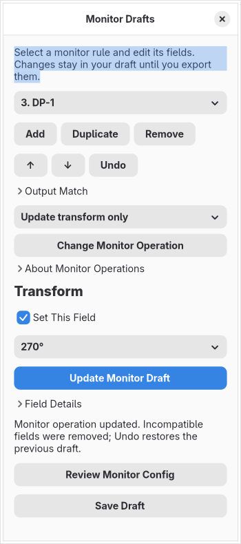

# Monitor draft editor — 0.5

Open **Menu → Edit Monitors**. This milestone supplies graphical controls for every monitor field in the checked-in source audit: 22 names (including the `reserved_area` alias), plus the output selector, for Hyprland 0.56.2 and audited-main. The exact commits remain in the audit register; `scripts/generate_catalogue.py --check` verifies the 44 field records against those pinned contracts.

Create ordered rules, choose fallback/connector/description matching, select one field and enable **Set This Field**, then **Update Monitor Draft**. Disabling a field and updating removes that field from the declaration; it does not force the upstream default. Expand Output Match when changing its selector. Rules support add, duplicate, reorder, remove and shared bounded undo. Separate version drafts survive snapshot switching; switching clears transient undo as in the scalar editor.

| Area | Graphical controls |
| --- | --- |
| Mode | Preferred, highest refresh/resolution, maximum width, dimensions with optional refresh, modeline clock/eight timings/sync polarities |
| Arrangement | Nine automatic directions or signed X/Y, automatic/numeric scale, eight transforms, mirror target selection/name, disabled |
| Color | All nine audited color modes; bit depth; transfer function aliases; SDR brightness/saturation/min/max luminance; HDR and wide-color overrides; HDR luminance metadata |
| Space/profile | Four signed reserved-area sides, either alias spelling; ICC path entry/file picker |

The diagram shows logical dimensions for explicit resolution and scale, including rotation. Automatic/unknown values use schematic sizes and positions. Dragging is enabled only for explicit size, scale and position; dropping changes draft coordinates and can be undone. Drawing runs when the model/window changes, with no periodic polling. Overlap is allowed. The diagram does not simulate rendering, determine hardware modes or validate a display arrangement against connected devices.

**Save Draft** stores rules with the scalar draft and optional source snapshot in a private `.hye` file, using the existing atomic storage checks and exact schema hashes. Reopening validates the monitor schema and reparses source bytes in the restricted worker without opening recorded original paths. Older scalar-only workspaces remain readable. Older app versions reject workspaces containing the new monitor fields; no backward migration is claimed.

Static, top-level `hl.monitor` literal tables and supported pure expressions can be imported without executing Lua. Output matching, declaration order and only explicit fields are retained. Duplicated table keys, conflicting aliases, unsupported fields and unresolved expressions produce diagnostics; arbitrary calls, includes, callbacks and branches remain opaque. Earlier projected declarations are not an effective-state guarantee once opaque code is encountered. Lua export produces ordered, quoted `hl.monitor` declarations; **Review Draft** includes Lua monitor drafts alongside scalar overrides. Explicit clipboard copying never applies anything and the exported fragment must not replace a full configuration.

Classic legacy `.conf` monitor declarations now use the same forms with four explicit operations: **Define monitor rule**, **Disable output**, **Update transform only** and **Update reserved space only**. The last two preserve their partial-update meaning and are never implicitly converted to Lua. The field picker follows the operation, and a single-field update omits the redundant picker. Partial updates hide the layout diagram; **About Monitor Operations** keeps the longer explanation collapsed until needed. Changing it keeps compatible fields and supplies the newly selected operation's editable initial values; Undo restores the prior rule. Existing separate Lua drafts require that explicit choice before legacy export.

Legacy definitions support mode/modelines, position, scale, mirror, bitdepth, color mode, SDR brightness/saturation, transform, VRR and ICC path. Reserved sides are converted between the legacy top/bottom/left/right order and the graphical top/right/bottom/left order. **Review Monitor Config** shows the ordered fragment; **Review Source Copy** combines it with scalar and session edits while retaining source comments and unresolved lines. Private projects reopen after the original is deleted and distinguish intentional empty targets from older separately saved drafts. No ICC file contents or hardware state are read by the source codec. The separate legacy `monitorv2` category, including its HDR/luminance fields, still needs source import/export support; its bytes are retained. Complete legacy grammar and effective matching remain unfinished.

The legacy handler and shared monitor parser are pinned in `data/legacy-monitors.json` to the [baseline source](https://github.com/hyprwm/Hyprland/blob/efb50993780079460b0cbed1363e2166a2de1d9f/src/config/legacy/ConfigManager.cpp#L1197). Transform-only updates require an existing matching rule upstream; reserved-space updates likewise have distinct matching behavior. Editing retains those declarations rather than pretending their effect is a full replacement. Finite parser/roundtrip fixtures do not certify native matching or physical hardware behavior.

Validation covers typed values, finite positive dimensions/refresh, numeric scale ≥ 0.25, transform and source-declared bounds, modeline timing order, selectors, duplicate identities and literal mirror cycles. Repeated rules for the same output remain ordered declarations; this editor does not resolve hardware matching or inherited effective rule state. A later explicit empty mirror removes an earlier edge for cycle validation. Reserved areas accept signed values, unlike scalar gaps. The two reserved spellings cannot coexist in a single rule.

The pinned upstream parser does not recognize its interlace flag after lowercasing it; the builder therefore does not offer interlace. Modeline fractional-clock behavior and all hardware outcomes remain unverified against a running compositor. Choosing an ICC file stores its path; contents, color correctness and HDR capability are not certified.

The captured-source inspector now supports comparison and private revision of existing monitor field value expressions and the exact output selector, including traceable original literals in another captured file. It uses the monitor controls, reports shared-expression effects, and retains the existing private revision/undo/save workflow. See [monitor source editing](monitor-source-editor.md) for the evidence and limits. The source inspector also adds fields through recorded constructors/writes, removes constructor or assigned fields with comment-preserving patches, and offers explicit repair seeds for invalid values. The Files pane also offers whole-declaration insertion/removal, including creating the first declaration or copying a selected typed draft. Reserved-area tables offer layout-preserving changes through selected or traceable original constructors, retaining comments and unrelated fields. General unsupported-expression preservation and changed-source reconciliation remain unimplemented. Review Monitor Drafts now offers explicit per-declaration copy/write/insert choices and observed-sequence replacement, with combined private graph/draft undo. Ordinary source edits still retain monitor drafts independently; reconciliation is an explicit choice. Preparing a scalar source copy is blocked when its monitor declarations differ from the monitor draft, so monitor edits cannot be silently left out. Monitor draft review/export remains available.

The **Detected Outputs** section now offers on-demand read-only connector and reported-mode selection. Refresh leaves the draft unchanged; explicit match and mode actions use the normal draft/undo path. See [monitor discovery](monitor-discovery.md) for transport, limits and fixture scope. Complete hardware inspection, live apply, rollback/recovery, nested compositor preview and physical-display acceptance remain explicit requirements in the original blueprint and completion register.
