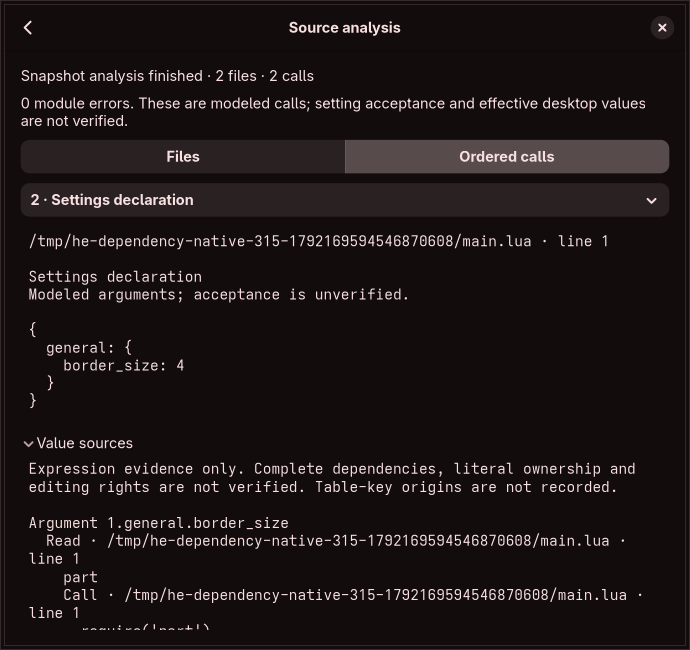

# Ordered immutable-module evaluation

[Primitive scalar family conformance](scalar-value-conformance.md) is available through a separate restricted-worker batch interface; registration-aware graph inspection is now connected, while complete API/effect semantics and editable graph import remain unfinished.

Captured calls also have [source-derived registry-dispatch inspection](config-table-inspection.md), separate from native acceptance and edit ownership.

`lua::replay` is the source-graph branch's ordered evaluator. It operates on supplied, immutable document bytes under explicit assumptions. The GUI now builds a temporary bundle through explicitly approved folder handles and shows captured files and modeled calls in order. It does not import those observations into drafts or save an editable multi-file workspace. All original audit obligations remain. No full feature or security gate is certified by this increment.

## Inputs and evidence

A program names an audited Hyprland snapshot, model profile, root document, optional initial `package.path`, optional working directory, documents and resolution bindings. Documents carry stable IDs, exact source hashes and byte-oriented load names. A resolution request includes the calling document/hash/span, loader kind, evaluated module bytes and current path/context. Bindings match that complete request. Duplicate or stale bindings and invalid target identities are rejected.

`initial_package_path_unknown_tail` distinguishes complete known templates followed by an uncaptured optional inherited tail from a fully known path or a wholly unknown path. Loader requests retain that distinction in `package_path_unknown_tail`; bindings with a different flag do not match. Local copies and table assignments preserve it, literal replacement produces a fully known path, and restoring a saved value restores its uncertainty. Prepending a known string preserves the known prefix. Other operations that need uncaptured bytes, including appending strings, equality, length, table keys and error text, remain unresolved and cannot be hidden by `pcall`. The model never reads this machine's Lua defaults to complete the tail.

`module_path::Context::plan_current` expands the current full path or known prefix without adding the main-directory pair again. Exhausting a known prefix remains an unresolved search. Empty full paths and empty templates retain Lua's actual failed empty candidates. The separate `normalized_load_path` transform matches the pinned explicit loader's lexical spelling only after a raw candidate's status check; it does not authorize access or prove inode identity. File loaders still need their actual working-directory context. The separate coordinator described below uses these plans with live capture evidence; the plans alone neither authorize capture nor import an editable graph.

Bindings are supplied observations or hypotheses. They do not prove path search order, file absence, ownership, containment, normalized-load identity or authorization. A bundle can describe a hypothetical module substitution. `runtime_verified` is always false. A missing binding halts with `NeedsResolution`; absence of information is never treated as a missing file. An explicitly supplied miss can produce a known protected-call failure, but its actual diagnostic remains unknown. No file is read by this evaluator.

The production profile conservatively leaves uncaptured global/package/library fields unknown. The separate synthetic `emit` profile fixes a private test environment. Production must not infer an absent native global from that test environment.

## Order and identity

Lexical environments hold shared cells, while each module receives its own local environment. Closures capture bindings visible at creation, retain outer mutations and do not acquire later local declarations. Tables and closures have identity; returning or caching a table shares that object. Statement order, evaluated function calls, argument/result adjustment, varargs, branches, lexical blocks, integer numeric loops, while/repeat loops and returns are modeled directly from syntax trees. Source files are never concatenated.

Require uses the existing source-derived cache transitions with a thin view of the requested key. It distinguishes the registry cache from rebound global `package.loaded`, false misses, nil completion, preloads, original require and supported safe-error fallback. `dofile` invokes the supplied document afresh; `loadfile` returns a fresh closure without invoking its body. Model uncertainty and resource failures propagate outside Lua error handling, including through `pcall`.

API argument observations and loader edges share a monotonically increasing order. Edges distinguish a cache hit, preload, supplied snapshot, supplied miss and unresolved request. Each retains the calling document/hash/span. A supplied snapshot means a selected input to the model, not a verified or successfully executed physical file. `hl.config` is currently an inert argument observer: it does not implement actual binding conversions, register configuration, prove acceptance or discover effective settings. Other Hyprland APIs still need their audited codecs connected to ordered evaluation.

## Compilation and isolation

Tree-sitter supplies the syntax nodes. Before a document is entered, its compilation result is checked using the system Lua 5.4 compiler. This catches errors such as assigning a constant or using varargs in a non-variadic function before any statement can be observed. The compiler's [load API does not run the chunk](https://www.lua.org/manual/5.4/manual.html#luaL_loadbufferx). The adapter opens no libraries, accepts text only, uses an 8 MiB allocator and never invokes the returned function. An allocation failure or a diagnostic exceeding 4 KiB is a budget failure, not an error safe require can hide. Compilation results for provided documents are currently prepared up front; unused syntax errors are not reported as entered-module errors.

Every report records the compiler-header release, linked library identity, applicable error-call line convention and profile-metadata hash. Lua 5.4.6 attributes a multiline `error` call to the callee line; 5.4.7–5.4.9 use the argument-opening line. The model applies only a recorded convention whose release also matches the linked library identity. An unknown or mismatched version leaves that location unresolved. This is an explicit assumption about the model's compiler/language profile; it does not detect or certify the target compositor's Lua dependency or patched-library behavior.

The application exposes this only through `ReplayModules` in its existing no-filesystem parser role. Environment clearing, closed inherited descriptors, no-new-privileges, closed syscall policy, 512 MiB address-space / 8 MiB stack / two-second CPU limits and the parent's three-second post-spawn deadline remain in force. The compiler introduces a native dependency and attack surface; fuzzing, sanitizer coverage and dependency-profile certification remain required. The worker has no preview, file grant, compositor connection or publication capability.

## Editor budgets

- At most 32 documents, 1 MiB per source and 4 MiB cumulative source; 512 supplied bindings. The worker additionally caps its entire JSON request at 4 MiB, including encoding overhead.
- Module names 16 KiB, search-path text 64 KiB, working-directory/load-name bytes 4 KiB. Unsupported NUL/path domains are rejected or left unresolved.
- 100,000 operation visits, 4,096 tables, 16,384 table entries/cells and 1,024 closures; expression/block/call depth limits of 128/64/32.
- Individual string values 64 KiB and cumulative string/name allocation 4 MiB. Environment copying charges operation visits.
- At most 2,048 API observations and 512 loader edges. Aggregate estimated output is 2 MiB, charging recursively expanded aliases and repeated loader-path bytes before retaining results. Snapshot depth is 32. Cycles use explicit references rather than recursive expansion. Transport responses remain capped at 4 MiB.

These are explicit editor limits, not Hyprland semantic limits or a measured whole-process memory certificate. Filesystem startup/I/O deadlines, GUI resource targets and large real configurations still need separate evidence.

## Verification and remaining work

`scripts/ordered_module_probe.py --check` fetches exact hash-pinned Hyprland loader helpers into memory and compiles them in a temporary directory with real Lua 5.4. Only private trusted fixture programs execute. Ninety-two observations across the two audited snapshots are stored in `data/ordered-module-fixtures.json`, including source/module bytes and the audit-manifest hash. The inert `hl.config` fixture records its argument only; it does not stand in for field codecs. Temporary upstream originals are deleted on exit.

`data/lua-profiles.json` pins official [Lua archive checksums](https://www.lua.org/ftp/), the canonical observation hash and exact release-specific differences. `scripts/lua_profile_probe.py --check` separately builds Lua 5.4.6, 5.4.7, 5.4.8 and 5.4.9, checks the application compilation adapter against each, then compares all 92 observations for each release (368 comparisons, not 368 distinct cases). Sources and builds are removed on exit. Unexpected differences fail with the affected case/field; unknown versions cannot silently refresh canonical observations. This is a partial tested profile, not a complete language, ABI, platform or target-compositor certificate.

The same matrix now checks `scripts/runtime_path_probe.py --check`: 83 direct Lua `package.searchpath` observations and 25 lexical normalization observations from identical hash-pinned helpers in both snapshots. Only private files/directories are inspected; no configuration Lua is executed. The fixtures deliberately distinguish readability from regular-file status: Lua can select a directory before actual loading fails. Permission, nonregular-node, native/custom-searcher, source-race and loading-diagnostic behavior still needs provider integration and its own evidence.

Core tests compare ordered traces, protected failure outcomes and error counts against those observations. Additional checks cover source/context identity, interleaved loader/API provenance, cyclic/shared values, repeated-path and table expansion, compile-before-observation, unknown native effects and control-flow budgets. Actual restricted-worker tests exercise compilation, shared module state, denied filesystem/network access, inert commands, malformed identities and bounded recursion/output.

Unimplemented semantics stay explicit: wildcard capture/replay, generic iteration, arbitrary custom/native loaders, metatables, complete standard libraries, all Lua byte-string/numeric/coercion domains, full error-stack/diagnostic formatting and complete native global state. They must be implemented or accurately represented as opaque dependencies before broad configuration support can be claimed. Captured graph construction, integration of scoped metadata/capture evidence with actual loader search order, full per-value provenance, all feature codecs, multi-file save/reopen/history/reconciliation, lossless source editing, effective discovery, isolated compositor preview, independent recovery, guarded apply and resource/security/release certification remain required.

## Captured-resolution coordinator and graphical analysis

`source_graph` coordinates the separate metadata/capture helpers and the closed parser worker. A selected immutable snapshot supplies the root and main-file spelling. The coordinator resumes `NeedsResolution` requests using observations from live approved folder capabilities; a matching filename alone is not substituted as proof of search order. It checks explicit candidates in source order, separately observes the raw status spelling and normalized load spelling, then captures and rechecks the selected regular source. Named modules use the current path's known candidates. Preload/cache behavior stays inside the evaluator. File loaders require a supplied working directory; neither the GUI's own directory nor this machine's Lua defaults are inferred.

The coordinator records positive/negative metadata observations, typed refusals and transport uncertainty per edge. Exhausted unknown tails, native/custom searchers, unapproved targets, nonregular nodes and unreadable files stop with partial results. A denied read is not silently treated as absence; complete stock searcher readability/fallback behavior remains required. Cross-grant alias/mount traversal and concurrent filesystem certification also remain open. These are sequential observations, not an atomic filesystem snapshot or detected effective configuration.

The same inode/hash loaded under different names retains separate document/load views and module cache keys. Metadata before and after capture must agree with the captured source identity and link evidence; changed revisions at one path are refused. Require compilation errors receive the source-derived file-searcher wrapper before protected error handling; runtime errors from entered chunks retain their original error objects. An independent reference case and real capture tests cover the distinction.

Limits are 32 load views, 4 MiB cumulative source, 128 supplied bindings, 256 metadata probes and an estimated 8 MiB encoded retained-data budget. A cooperative ten-second analysis budget and cancellation checks surround helper/model steps; the existing helper budgets/quarantine remain. The GUI reserves only the remaining part of its session's 8 MiB budget. Startup, kernel-uninterruptible I/O, allocator overhead and whole-process resources are not certified by these data limits.

**Review Dependency Files → Analyze File** treats the selected captured snapshot as the main file. A separate results page has Files and Ordered calls tabs, one selected source/call pane, explicit partial status and a Stop action while working. Root/draft version, source hash, generation and operation epoch guard acceptance. Closing, removing the source, starting another operation or detecting a changed draft clears results; cancellation stops further coordinator steps. A temporary UI-only half-second token check catches stale open reviews, with no filesystem polling or compositor subscription. Analysis records contain bytes/evidence, not reusable folder handles. The separate Analysis Context dialog now supplies absolute home/working folders and exact inherited-path hypotheses; these do not grant access or prove runtime values. Full arbitrary-home authoring, argument pagination, all API codecs, draft import, persistent graphs and source edits remain required.

For private diagnostic fixtures, `hyprland-editor --check-source-graph FOLDER ROOT VERSION [CWD]` uses the same coordinator. It reports identities, load names, observations, calls and blocking reasons without printing raw source text. `model_completed` describes only the supported model; `runtime_verified` and `atomic_filesystem_snapshot` remain false. No user Lua is executed or configuration written.

## Per-value expression evidence

Modeled values now carry an optional expression ID separately from their Lua kind. Lua equality, table/closure identity, cache keys and cache transitions ignore that metadata. Copies through cells, table values, aliases, module returns and closure parameters retain the selected prior value. Each successful expression result records its immutable document index, byte span, line, result position, expression kind, selected prior value and executed child-expression IDs. Edges point backwards into the bounded arena; documents remain pinned by the supplied bundle's source hash and load name.

API observations pair their argument snapshots with matching value-source trees. Table value rows keep the same order as their paired observed rows; cyclic references stop expansion. Equal primitive values from different literals retain different locations. Computed expressions expose their evaluated operands instead of inventing a single literal owner. Initial libraries, missing/default values, generated loop values, some error/fallback transformations and declaration-created closures can lack a prior source. Missing evidence stays absent.

The graphical **Value sources** section is collapsed by default under the selected settings call. It shows bounded source locations and selected expression chains, with explicit uncertainty. Non-identifier byte keys use a distinct byte spelling so dotted keys cannot be mistaken for nested values. Rendering permits 32 leaves, 96 expression visits, eight levels and a final 16 KiB text excerpt; clipping is marked. No source is opened by clicking or rendering this evidence, and no edit action is enabled.

This is expression evidence, **not a complete def/use, control-flow, table-key, assignment or ownership graph**. Executed-child edges can include selector, argument and control effects; they are conservative evaluation dependencies, not minimal dataflow or interchangeable edit targets. Standalone return/error observations do not yet have parallel public value-source trees. Full per-value ownership, consumer-impact analysis, every API codec, changed-revision reconciliation and mutation authorization remain required before editable graph import.

The arena permits 8,192 result nodes, 32,768 edges and 256 active expression frames, sharing the existing estimated 2 MiB output budget. Budget failure remains a model halt that pcall cannot swallow. Value-source expansion follows already bounded immutable observation snapshots. These are logical bounds, not the whole-process PSS, startup/I/O, supported-kernel or release certificates.

Tests cover both audited versions, distinct equal literals, imported values, aliases and mutation, closure/multiple returns, cached table identity, expression ranges/lines, acyclic backward references, serialization, cycles and budget refusal. Existing 92 reference observations still match modeled values. The native workflow displays an imported literal's source and checks the measured 350-pixel minimum width. The stale-result fixture now waits for the exact completed operation rather than assuming cleared UI pending state means a helper finished. Current local validation passes 227 ordinary tests plus one private-display native workflow (228 total), strict lint, formatting, release and metadata checks.

