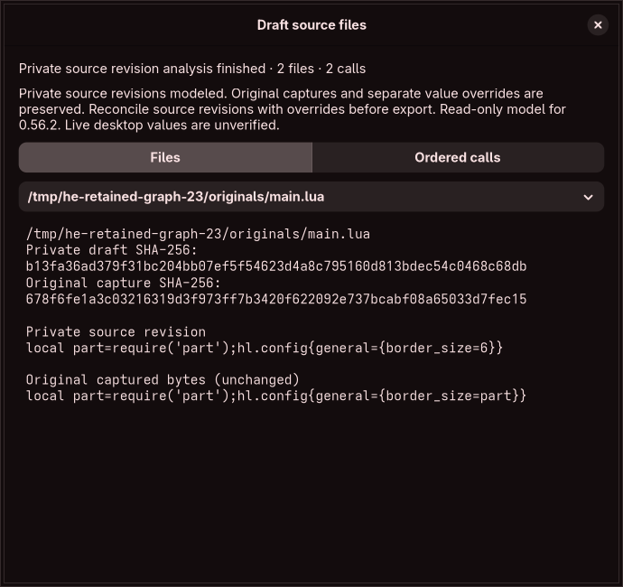

# Private source revisions, save/reopen and undo

After a graphical source comparison, **Keep in Draft** retains its proposed change in the private source graph. **Save Draft** persists that graph in the `.hye` workspace. Opening the retained source view shows the current private revision and the original captured bytes separately. Original files, recorded capture identities and temporary folder permissions are not changed by keeping or saving a source revision.

The action requires the imported root at its exact recorded revision. It checks the comparison epoch, immutable analysis identity, current graph fingerprint, selected snapshot and draft generation. If another edit changes the draft while a revision is being prepared, its result is discarded. A retry can keep the source change without overwriting a separate value override. The native workflow exercises that race explicitly.

Source revisions and ordinary value overrides are separate draft layers. The application preserves both. **Override-only export is blocked while source revisions exist**, because it would omit the revised source and could contradict it. Full graph/source/override reconciliation remains unfinished. Keeping a private revision does not certify source ownership, native behavior or live publication.

## Representation and trust

Captured `SourceSnapshot` bytes and `SourceIdentity` records remain immutable. A graph revision records its document ID, original and current SHA-256, inserted text buffers, and pieces referencing either original byte ranges or inserted-buffer ranges. Inserted buffers serialize once per revised document. Original pieces remain ordered and cannot duplicate captured ranges; all ranges must be valid UTF-8 boundaries. Hash, size, buffer-index and reachability checks reject inconsistent data. Restoring captured bytes removes the redundant revision.

Unchanged loader calls must remain wholly within original pieces. Their historical requests receive the exact new byte offsets and containing document hashes; module/path/context/target inputs are not guessed. Changing a loader call requires renewed resolution input. Changing data which computes a module request may instead produce an unresolved request in the model. Such partial results do not become effective-state or filesystem certificates.

Byte generation uses the trusted client's bounded Rust operations. Syntax checks and modeled evaluation run in restricted workers. A materialized worker response must match the independently generated input fingerprint; it cannot substitute other proposed source bytes. Original graph reachability is rebuilt before private revisions are modeled. Edited control flow may make an original dependency unreachable, but its captured input is retained rather than silently discarded. No saved parser report or observation becomes write authority.

Reopening rebuilds the current pieces directly, rather than replaying an ever-growing operation journal. It compiles/reparses revised documents and then rebuilds their model without opening recorded paths or restoring folder grants. This preserves existing explicit partial/unknown states. Compiler/model pins remain mandatory; migration/reanalysis for older incompatible pins is still required.

## Memory, history and limits

Graph versions share the captured source array through `Arc`; unchanged inserted buffers also share immutable allocations. The undo estimate counts a shared captured array once across retained graph inverses, while metadata estimates stay conservative. Graph fingerprints and component sizes use bounded streaming serialization rather than an additional full JSON string. Edited-program bytes replace the original-program charge in the analysis's retained-data accounting.

There are at most 32 source load views, 8,192 total pieces, 1 MiB per materialized document and 4 MiB of inserted-buffer data across the graph. Existing input/workspace/worker/time limits still apply and may reject an oversized combination. These are logical data limits and estimates, **not certification of the 100 MiB whole-process target**. The last whole-GUI measurement exceeded that target.

Keeping a revision participates in the existing shared, bounded **within-session undo** and dirty/save tracking. A late save cannot clear a newer undo or source change. Workspaces persist the current private source state; operation history, checkpoints and undo across application restarts remain unfinished. Original captured bytes are retained for inspection and future reconciliation/restoration, independently of that missing persistent history.

## Evidence and remaining work

Five core cases cover sequential edits inside inserted text, shared buffers, restoration, UTF-8/CRLF preservation, loader rebasing/refusal, partial models, forged metadata and limits/syntax. The actual worker checks revision transport/materialization and refuses forged hashes. The application save/reopen test runs both audited snapshots after deleting all original fixture files, retaining original identities and separate overrides. The graphical workflow keeps a revision, rejects a concurrent draft edit, checks shared capture allocation and blocked partial export, saves/reopens, and exercises undo/late-save behavior. Its rendered view is inspected.

This does not complete field insertion/deletion ownership, every feature-family source editor, rejected/unobserved-value repair, physical alias/mount/concurrency certification, generated/config-manager handling, graph reconciliation or persistent history. Complete discovery, isolated compositor preview, guarded apply/independent recovery, resource targets, accessibility/localization, packaging and the original audit/security/release gates remain required.
