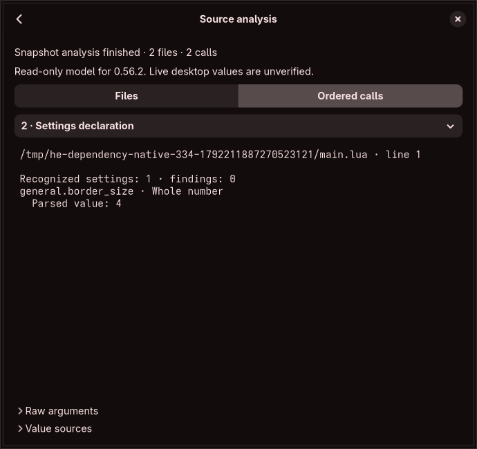

# Registration-aware source inspection

Captured `hl.config` arguments now receive per-value models from the selected frozen Hyprland snapshot. The GUI shows a converted value, a rejection category, or an explicit unsupported result. This is read-only inspection of immutable argument observations. It does not import an editable multi-file workspace, detect effective desktop values or authorize source writes.

## Independent registration evidence

`scalar_registration_probe.py` verifies 58 source hashes and compiles the original option structs, four primitive generic value classes/constructors, factory, complete standard registration function, primitive Lua constructors, generic-to-Lua conversion, key normalization and device-value constructor. Runtime lookup, refresh, complex constructors and compositor services are inert. Only the isolated original bootstrap registration statement runs; the real manager constructor, config-path discovery and watcher do not run. Original sources and builds are temporary and removed.

The probe observes 353 baseline and 402 audited-main standard settings, 46 device value fields per snapshot and one separate bootstrap key per snapshot. Every standard registration's type and raw metadata expression is checked against the original audit, ignoring only whitespace/comments outside literals. This binds the literal choice vectors to the frozen source instead of treating a finite sample as an exhaustive validator. The observed integer maps, binary32 bounds/defaults and validator results are distinct from the resulting Lua constructor arguments.

`generate_scalar_semantics.py` emits 849 scoped records: 755 standard, 92 device and two bootstrap records. The runtime file uses one compact JSON record per line, approximately 336 KiB, under a 512 KiB data limit. Reference fixtures/source files are not embedded in the product. Complex defaults/codecs remain absent rather than fabricated. Device parent selection follows the original first-duplicate-wins constructor; separately handled tags/name selectors are outside that value list.

## Confirmed version difference

The [baseline conversion](https://github.com/hyprwm/Hyprland/blob/efb50993780079460b0cbed1363e2166a2de1d9f/src/config/lua/types/LuaConfigUtils.cpp) passes only defaults into Lua values. Declared numeric bounds, integer maps and validators are dropped. The [audited-main conversion](https://github.com/hyprwm/Hyprland/blob/6a1b5f0fbfa169d4e6cf2f49a5f919a273aeaec7/src/config/lua/types/LuaConfigUtils.cpp) forwards them.

Accordingly, baseline Lua can accept `general.border_size = 30`, while the newer model rejects it against maximum 20. A named integer alias such as `top_left` is rejected by the older backend and recognized by the newer one. The newer input profile rejects unlisted acceleration profiles; baseline Lua does not receive that validator. Generic declarations remain available as advisory metadata; they are not silently substituted for the actual Lua constructor parameters.

The three literal `strChoice` validators use exact byte membership. Primitive string conversion, including NUL truncation, occurs before validation. Existing opaque validator-name requests remain unresolved. Unknown validator shapes and future registration drift fail generation rather than invent acceptance.

## Worker, evidence and UI

`InspectConfiguration` runs in the existing restricted parser process. It receives immutable `hl.config` observations, uses built-in versioned metadata and returns the registration schema hash, matching library profile and C numeric locale. The coordinator checks those identities against the source report. No imported Lua, callback, refresh, watcher, runtime IPC, source fetch or user command executes.

Each candidate retains its raw key segments, row coordinates and optional expression ID. Per-value outcomes remain separate from same-call ambiguity and source ownership. Known rejections do not invent a setting change. Unknown complex codecs, table cycles and resource failures produce partial results; later inert argument observations are not assigned native value models after an unresolved API boundary. The language evaluator remains an argument-observation model, not native API/effect execution. No final effective state is inferred from its later observations.

The per-call estimated 512 KiB evidence limit now includes typed outcomes. Worker output also has a shared estimated 2 MiB bound and existing CPU/address-space/envelope/deadline limits. The coordinator retains a fitting prefix within its shared estimated 8 MiB session bound. Empty call sets skip the extra worker. Captures/grants, draft generation, hashes, context and operation epochs keep their existing invalidation rules. These data bounds are not a whole-process resource certificate.

The selected-call view puts recognized settings and parsed values first. Raw arguments and value sources are collapsed and mutually exclusive, with one concise read-only/live-state notice. Key/value/control bytes remain escaped, long output is explicitly clipped and the 350-pixel minimum width remains tested. Field/finding/argument pagination and complete per-value ownership navigation remain required.

All `native_values_verified` and runtime verification flags remain false. An accepted value means the selected source model accepts that immutable input under its explicit library/locale assumptions. It does not prove target build/dependency/locale, complete native effects, source editability or successful application. Ordinary scalar/device forms and static source projection still need integration with these effective constraints; in particular, their older declared bounds must not be treated as proof of baseline Lua acceptance.

## Scope corrections remain mandatory

The compiled device constructor exposes four fields omitted by the original 43-field device register:

| Field | First generic parent |
| --- | --- |
| `eraser_button_mode` | `input:tablettool:eraser_button_mode` |
| `eraser_button_override` | `input:tablettool:eraser_button_override` |
| `pressure_range_min` | `input:tablettool:pressure_range_min` |
| `pressure_range_max` | `input:tablettool:pressure_range_max` |

There are 46 native device value fields plus separately handled tags: 47 public fields before the name selector. The separate `autogenerated` Int/default-zero registration also lies outside the standard scalar catalogue. It is now recognized during source inspection, while its editor/source-ownership control remains required.

The [scope findings](registration-scope-findings.json) feed five mandatory supplemental obligations into the completion register. All 1,453 original contracts remain intact. The four device additions now have draft controls, static source codecs, private persistence and undo checks. Full device source ownership/editing/reconciliation, native/hardware behavior and generated-config handling remain unfinished; the original contract count and historical partial-coverage figure are not exhaustive completion measures. Five complex scalar families, full API/language/ownership models, editable graphs, effective discovery, isolated compositor preview, independent recovery/guarded apply and every resource/security/release gate remain required.

Current local checks pass 239 ordinary tests plus one private-display native workflow (240 total), strict lint, formatting, release/metadata checks and the independent registration probe. The native workflow verifies an imported parsed value/source trace, unchanged draft generation, collapsed diagnostic sections and minimum width. No full contract is certified.

