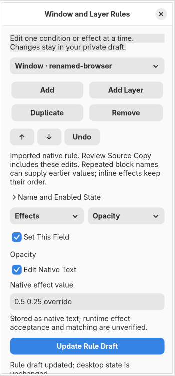

# Window and layer rule editor

This milestone adds focused controls for all 57 baseline / 60 current window effects, ten layer effects in each pack, the 17 consumed window predicates and the layer namespace predicate. Name, enabled/unset, ordered declaration management, independent named duplication, removal, bounded undo, static Lua import/export, schema-pinned private storage and original-source omission guards are integrated into the application. It does not close the 94 complete RULE contracts.

## Declaration identity and effect ordering

Each draft record represents one `hl.window_rule` or `hl.layer_rule` call. Its effect fields form a Lua table. The source binding traverses that table with `lua_next`; textual field order is not a runtime ordering guarantee. The editor preserves this group boundary and provides relationship findings.

A nonempty name reuses the first rule of that kind with the same name. The original registration position remains. A later call resets enabled to its own value (default true), replaces supplied predicates, leaves omitted predicates present and appends its effects. Window and layer names have separate maps. Empty or absent names create independent rules. Empty conditions do not match everything: `canMatch` requires at least one predicate and enabled state.

**Order Named Effects Explicitly** deliberately replaces a multi-effect named call with consecutive single-effect calls in the displayed order. It retains the name and enabled state, keeps predicates in the first call and requires a nonempty name. This selects a definite order where the original group had none guaranteed; it is an explicit draft change with undo. Duplication assigns a fresh draft identity and a fresh nonempty public name when needed, avoiding accidental effect accumulation into the original.

## Controls and literal projection

Only the selected condition/effect form is created. Regex conditions offer exact text or a regular expression and an independent negation control. Exact text is escaped for RE2, including the special `negative:` marker. Sample checks use the existing resource/syscall-restricted worker, full-match semantics, bounded input and an 8 MiB RE2 allocation policy. Invalid patterns produce an error, including invalid negated patterns. Stale checks do not label changed inputs as matched. No live window or layer is inspected by these sample checks.

Geometry accepts two string/number axes, original combined text or the upstream empty-string clearing sentinel. Untouched numeric axes preserve their input types and full integer range. Changing an axis authors a string expression. Expressions are never evaluated. MuParser grammar, variable availability, actual dimensions and placement still require isolated compositor validation and a complete graphical expression builder.

Typed scalar fields retain false/zero values and literal bounds. Integer/float entries avoid artificial spinner bounds. Structured gradients use the existing color form. Imported legacy active/inactive border text remains available and is exported as text through the source binding's legacy fallback. The [0.10 structured controls](rule-semantic-controls.md) add border pairs, opacity, fullscreen state, grouping, event and mode selectors with primitive parser evidence. Complete geometry/style/monitor/workspace/action selector builders and full runtime conformance remain required. Some fields still use literal text.

The parser recognizes static tables and restricted pure locals. Calls, plugin effects, ambiguous duplicate keys, unknown structures and unsupported coercions remain opaque. An evaluated unresolved argument invalidates trust in later API calls. No Lua, hook, command or plugin is executed. Window-only and layer-only predicates are kept separate because the consumers do not use every globally registered property.

Imported rules participate in draft dirty state, save/reopen, reviewed combined Lua and source-copy omission checks. Undo estimates include retained rule strings/vectors and source reports. Original rule insertion/deletion, source-span editing, named-object references/toggles and multi-file reconciliation remain open.

## Evidence and limits

- Core tests cover all effect fields in both packs, all consumed predicates, clearing/typed geometry, ambiguous and opaque fields, named accumulation, effect group boundaries, regex prefix/escaping/errors, private schema pins, identity and size policy.
- Actual restricted-worker tests cover inert rule projection, preserved scalar copies, unresolved evaluated arguments and RE2 samples.
- Application tests reopen saved rules after deleting the original and refuse schema tampering without opening recorded paths.
- Native GTK tests exercise both window packs and layer controls, sample checking through the real application worker, field switching, full-range integers, invalid input, duplication, explicit ordering, undo, untouched imports, export, saved models and cleanup of closed controls.
- `scripts/rule_source_probe.py` extracts reviewed functions from exact SHA-256-pinned sources into a temporary C++ fixture. With real Lua 5.4 and RE2, it checks public named registration, enabled reset, retained supplied/omitted predicates, effect accumulation, first registration position, empty matches, Lua integer conversion and regex FullMatch. Effect descriptor parsing, predicate engine storage and userdata services are mocks. This is narrow evidence, not a compositor/effect-parser/hardware certificate.

RE2 development headers and a C++17 compiler are application build dependencies. The optional source probe additionally needs Lua 5.4 development headers and C++23. Ubuntu: `libre2-dev liblua5.4-dev`; Arch: `re2 lua`. The application links RE2, not Lua.

Actual effective rule discovery, plugin packs, named-object lifecycle, complete semantic builders, general dynamic source editing, compositor conformance, isolated preview, live apply/recovery, accessibility and repeatable resource acceptance remain required. The completion register keeps every full contract unproven.

## Native configuration rules

The native schema records hashes for the pinned [configuration loader](https://github.com/hyprwm/Hyprland/blob/efb50993780079460b0cbed1363e2166a2de1d9f/src/config/legacy/ConfigManager.cpp), [match-property registration](https://github.com/hyprwm/Hyprland/blob/efb50993780079460b0cbed1363e2166a2de1d9f/src/desktop/rule/Rule.cpp) and effect containers. Research used in-memory source reads; no upstream tree is retained.

Literal flat `windowrule` and `layerrule` blocks and top-level inline declarations now populate graphical rule controls. The baseline registration profile covers 57 window effects, ten layer effects and all 18 registered match names. Names/values depending on variables, nested/conditional syntax and unknown fields remain unresolved. The older `windowrulev2` grammar is not silently converted.

Native values retain their string representation independently of Lua tables. **Edit Native Text** preserves values outside a guided builder; unchanged guided controls retain the exact imported spelling. Native conditions also expose registered fields that the selected modeled matcher does not consume, with an explanation. Raw text is saved without certifying runtime acceptance. Regex sample checks remain samples, not inspection of real windows.

Inline effects retain order and repeated effects. Editing a selected effect changes the last occurrence; unsetting removes every occurrence of that key. Named blocks retain the last value per field. Source updates change the last duplicate assignment and preserve earlier assignments/comments; unsetting removes all assignments within that block. An earlier block with the same name can still supply an omitted field. Native named blocks load separately before inline rules; the displayed declaration order is not certified effective compositor ordering.

**Named Rule** explicitly chooses a block rather than an inline declaration. A block requires a nonempty name. Converting repeated inline effect keys into a single block is refused because it would collapse the sequence. The Lua-specific **Order Named Effects Explicitly** operation is unavailable for native rules. Duplication, reordering, remove, undo and existing pending-form guards remain available.

The pinned loader uses an integer `enable`: explicit zero suppresses a window block; explicit nonzero suppresses a layer block. The GUI labels these version-specific loader choices and retains other signed integers. Unspecified enable remains distinct from an explicit value. These semantics describe the pinned source, not a claim about later Hyprland releases or a correction to upstream behavior.

**Review Source Copy** includes all nine native groups: scalar settings, session directives, monitors, bindings, workspace rules, animations, gestures, devices and window/layer rules. The combined copy preserves comments/unresolved statements and reparses all supported projections. Export remains a reviewed separate file; it does not reload Hyprland. Captured source/codec markers preserve intentional empty rule targets; older projects rebuild recognized native declarations without discarding separate Lua drafts or rewriting old files. Original configuration paths need not exist when reopening.

Native rule names, conditions and effect payloads are omitted from ordinary preview preparation. Native keyed-block merging, runtime matcher/effect acceptance, plugins, complete expression/selector builders, old dialect conversion, effective-state discovery, actual isolated preview and live apply/recovery remain required work. This increment does not close the full RULE audit contracts.

