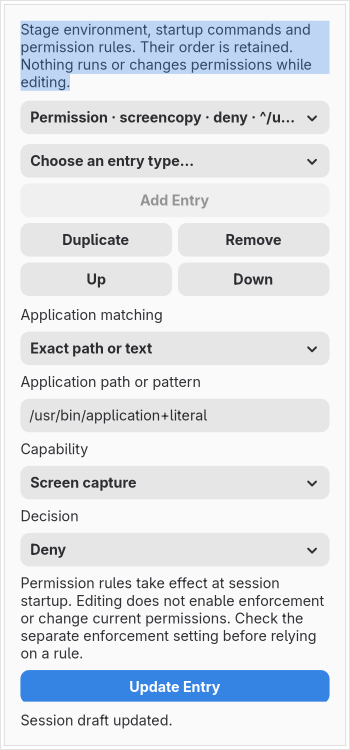

# Environment, startup commands and permission rules

**Menu → Environment and Startup…** opens an ordered draft editor. Choose an entry type, add it, update its fields, duplicate/remove it or move it up/down. Changes join normal undo and private project saving. They do not change the editor's environment, start a program, update activation services or install a permission rule.

Environment entries have a variable name, a multiline value and an optional activation-service flag. Empty strings remain empty; unspecified and explicit false remain distinct. The editor accepts safe ASCII variable names to avoid generating unsafe activation-service command names. Values are quoted as Lua strings, without expansion or host-environment lookup. Imported expressions such as `os.getenv(...)` remain unresolved rather than reading the editor's environment. The versioned API and optional flag are pinned to the [baseline handler](https://github.com/hyprwm/Hyprland/blob/efb50993780079460b0cbed1363e2166a2de1d9f/src/config/lua/bindings/LuaBindingsConfigRules.cpp#L478) and [audited-main handler](https://github.com/hyprwm/Hyprland/blob/6a1b5f0fbfa169d4e6cf2f49a5f919a273aeaec7/src/config/lua/bindings/LuaBindingsConfigRules.cpp#L483).

Command entries have a command and a graphical trigger: each configuration load, session start, configuration reloaded or session shutdown. The last three emit a literal lifecycle callback containing the command. A configuration-load command is emitted directly. The command string is retained without execution or executable discovery; the new-entry example must be replaced with the intended command. Exporting a command does not make its eventual effects reversible. See the pinned [command/event handlers](https://github.com/hyprwm/Hyprland/blob/efb50993780079460b0cbed1363e2166a2de1d9f/src/config/lua/bindings/LuaBindingsToplevel.cpp#L321).

For an imported baseline `.conf`, the same editor projects supported environment, launch and permission directives. Commands also offer **Legacy launch mode**, preserving raw versus inline-rule parsing instead of silently converting their meaning to Lua. Reload-only and raw-shutdown combinations are rejected while retaining the form. Supported scalar and session changes share **Review Source Copy**. Literal hash/brace/backslash encoding is available for session values; variable expansion and unsupported legacy declarations stay unresolved. See the [legacy workflow](legacy-source-editor.md) for the precise boundaries and older-project handling.

Permission entries select screen capture, cursor position, native plugins, keyboard input or input capture, then Ask/Allow/Deny. Application matching has exact-path, prefix, suffix and contains builders. Existing expressions are preserved; patterns produced by the literal builders reopen as graphical choices. Validation runs in the restricted worker, and rejected text remains in the form for correction. These rules are registered at first launch by the pinned handlers. Enforcement is a separate scalar setting; editing neither enables it nor changes the active policy.

Static imports recognize literal/known environment values, direct commands, supported single-command lifecycle callbacks and both permission argument forms, including the `target` and `keeb` aliases. Other callbacks, multiple-command bodies, optional command launch-rule tables, unknown fields, unsafe names and dynamic values remain unresolved. Their original bytes stay in captured sources. These are explicit editing gaps; source preservation does not count as full graphical workflow support.

Captured declarations can use **Edit / Compare This Declaration**, and Files → Add a Declaration includes environment, startup-command and permission templates. Those forms edit a temporary draft until Compare/Keep. Comments, unrelated source, loader coordinates and module returns use the existing source-review machinery. Named or arbitrary callbacks are never executed to recover values.

The [combined project-copy review](combined-project-copy.md) now has nine groups. The new session group can be kept, appended or explicitly replace reached supported calls. Replacement refuses a group containing callbacks or declarations that this editor cannot represent, preventing an environment change from silently deleting unrelated event handlers. The single-file copy workflow also includes session drafts and independently reparses the result. Appending/moving declarations can change their ordering relative to commands in other groups/files; review the copy before manually integrating it. Verified relocation and guarded live installation remain unfinished.

Session drafts carry a schema pin in `.hye` projects. Version 2 adds an explicit legacy command variant; the frozen version 1 schema remains readable for its original variants. Existing projects without session data remain readable. The source-model transition rebuilds captured graphs under explicit review. The model has 101 inputs and 28 reviewed predecessors, retaining captured inputs and compiler observations. Legacy source/codec markers preserve intentional removal and distinguish older separate drafts from a projected source target.

Ordinary preview preparation excludes environment, command and permission declarations and records each omission without copying its sensitive payload. It never forwards the host environment or executes these entries. Real isolated preview, workflow lifecycle ownership, full runtime validation, safe activation/recovery and complete audit acceptance remain required.

The typed draft is bounded to 256 entries, 16 KiB strings and 1 MiB rendered output. Existing source, project, worker and undo limits remain in force. The implementation adds no resident service or idle polling. Source checks used the exact two audited revisions and matched all four handler-file hashes recorded in `data/session.json`; no downloaded repository or source tree was retained. This is not a full native-handler or security certification.
