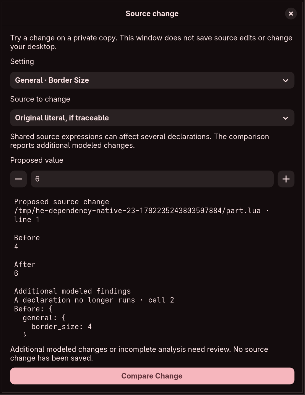

# Compare a captured source value graphically

In **Source analysis → Ordered calls**, select a recognized settings declaration and choose **Compare a Source Change**. The window lists its captured settings with their category context. Supported primitive values use a switch, exact numeric input/step buttons, plain text input or recorded native choice controls. The numeric control preserves signed 64-bit integers and negative zero without silently converting the input to a rounded display value. Unavailable native representations and ambiguous keys explain why their comparison control is unavailable.

Choose **Selected value expression** to replace the recorded expression at that value, or **Original literal, if traceable** to follow its selected-value history. Both choices name a source expression; neither claims exclusive ownership. For example, changing a `size` reference in one declaration may leave another declaration intact, while changing its original shared `2` literal can affect both. An arithmetic expression can be replaced explicitly; the engine refuses to guess which original operand the user intended.

**Compare Change** sends immutable graph input, setting identity/coordinates, selection and typed value to a restricted worker. The worker independently rebuilds the model and registered field inspection instead of trusting GUI-supplied source offsets or a saved report. It checks the desired typed value through the exact snapshot's native parsing model, uses fixed printers and generates the existing source-bound change plan. Typed negative-zero floats retain their Lua floating kind; the minimum signed integer uses an exact integer expression; strings are quoted data. Unsupported/nonfinite/unrepresentable results cannot become accepted proposals. Named integer routes and string choices remain tied to the recorded native codecs, independently of declared editor metadata.

The result identifies the proposed document/line and before/after expression. **Keep in Draft** now retains the change privately; **Save Draft** persists its source revision, with original captures intact. See [storage/undo scope](private-source-revisions.md). It compares the intended call arguments with the other modeled calls, loaders, execution-path outcomes and returns. Additional findings use plain descriptions such as “A declaration no longer runs” or “Branch or loop behavior changed.” An original literal in a dependency can change the branch which decides whether its caller's settings declaration runs; that impact remains visible instead of being labeled as only a local field change.

## Lifetime and scope

There is one active comparison window per source inspector and one in-flight source-comparison worker across these windows. Inputs remain responsive while work runs, but their epoch changes invalidate the old result. A different analysis blocks the old window; closing discards its proposal and callbacks cannot restore it. Opening an active comparison reuses it; reopening a closed one creates a fresh session. Excerpts and result envelopes remain bounded. Before rendering, source document/range/old-byte identity and unavailable verification claims are checked. No filesystem permission, current-file certificate or compositor handle is obtained by this workflow.

The native workflow exercises a successful selected-expression comparison, an original dependency literal which removes a declaration, changing inputs in flight, model replacement in flight, close/reopen/reuse, exact numeric controls, a choice control, unchanged source files/draft generation and the 350-pixel minimum layout. Its screenshot is inspected. Five core tests cover selected/shared/computed expressions, cross-document branch effects, both snapshot constraints, primitive printing and unsupported inputs; a real worker test verifies independent coordinate reconstruction and validation.

All four pinned Lua 5.4.6–5.4.9 runs now additionally execute a tiny trusted, library-free literal fixture checking integer minimum, float kind, signed zero and escaped string bytes. This fixture contains no user source and loads no Lua libraries. The existing 100 ordered, 108 path/normalization and 592 primitive parse observations per release still match; downloaded originals/builds are removed.

This is a **source-value comparison**, not the isolated compositor preview. Comparing alone changes no draft. Keeping and saving now persist private source revisions with within-session undo; imported files are never overwritten. Source/override reconciliation and persistent operation history remain next. Repairing rejected/unobserved declarations, complete ownership/future effects, complete accepted-domain controls, compound trivia ownership and all feature-family edits, live-state discovery, isolated compositor preview, guarded apply/independent recovery, memory targets and every original audit/security/release requirement remain open. A matched source model grants no ownership or live-write authority.

[Complex value controls](complex-value-codecs.md) now add all five compound families. Value controls fold after comparison to make room for review; reopen Proposed value to edit. A whole compound expression replacement explicitly includes comments and extra fields within that expression. Full lossless field editing remains required.

Directly selected vector, gap and gradient tables now default to [preserving their source layout](compound-source-layout.md). Existing comments, whitespace and unrelated fields survive component changes and supported insertions/removals; unchanged native components retain their original spelling. Layout refusal is explicit and never falls back automatically. Full-expression comparison remains an explicit alternative.

For a compound table reached through a variable or module return, **Original table layout, if traceable** explicitly selects its recorded constructor. Shared uses and later overwrites remain review findings. This never chooses a definition by comparing equal values or adds permission to read a referenced path. Primitive settings retain their two expression/literal choices.
