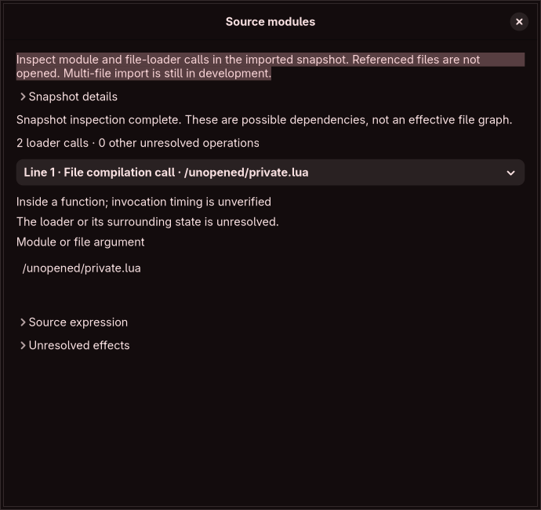

# Source graph implementation work

This branch starts E03/E05. It is not yet a multi-file editor, and it does not relax the application's refusal to reopen unsupported multi-file workspaces. The full audit remains authoritative; no additional feature contract or security gate is marked complete.

## Implemented candidate planner

`module_path::Context` carries the exact main filename, optional captured home path and optional inherited Lua search path as byte arrays. The planner never queries the process environment or filesystem. Unknown inherited search paths remain an explicit unknown tail, distinct from a captured empty path. Both audited snapshots have the same inspected initial path rules. These plans describe the upstream initial loader; modified `package.path`, searchers, preload/cache state, aliases and arbitrary Lua still require graph evaluation and provenance.

Explicit modules begin `/`, `./`, `../` or `~/`. Relative explicit paths use the main configuration filename's directory, including the upstream helper's string replacement behavior. File candidates are the exact base, `.lua` when not already suffixed, and `init.lua`. The original Lua-file searcher remains a fallback after explicit misses; a preloaded/cached module or another searcher can take precedence. A candidate is not proof that a file is read or a permission to read it.

Explicit wildcard plans retain the raw pattern and raw directory candidate preceding its first metacharacter. The directory must actually exist before upstream records its lexically normalized watcher path. The planner does not enumerate directories, follow symlinks or claim watcher delivery. Actual globbing, regular-file filtering, normalized/sorted/unique results and missing-match categories are preserved in independent source observations for the forthcoming authorized resolver.

Named file-search plans apply the initial main-directory template pair and the captured inherited templates, replacing dots in the module name and question marks in templates according to observed Lua 5.4 searchpath behavior. Empty inherited entries are retained as failed candidates; a wholly empty inherited string is omitted by the Hyprland constructor. Repeated separators at the main filename boundary differ between the raw `absolutePath` helper and C++ filesystem parent/join operations; tests preserve that difference.

Path bytes are kept intact, including non-UTF-8 evidence. Candidate paths retain `..` and symlink-sensitive components until the appropriate source-derived stage. In the source fixture, checking a symlink/../ path and subsequently normalizing its chosen load filename can refer to different physical locations. The future graph capture must record and authorize both stages; lexical normalization is not a filesystem containment check.

The restricted parser worker has a typed `PlanModules` request. It receives only bytes and an audited version; filesystem, network and process-creation restrictions remain active. Limits are 16 KiB per module/main/home path, 64 KiB inherited search text or expanded candidate, 512 templates/requests, 1 MiB aggregate candidate bytes per plan and 2 MiB encoded batch results. Existing worker request/response/CPU/memory/deadline limits still apply. Oversized expansion fails explicitly before returning a partial plan. These are editor budgets, not upstream semantic bounds or a large-config certification.

## Evidence

`data/source-graph-semantics.json` retains immutable SHA-256/Git-blob provenance. `scripts/source_graph_probe.py --check` compiles actual upstream path/candidate/glob/watcher helpers and `absolutePath` for both source snapshots. It observes 43 private-file cases per snapshot, with direct Lua 5.4 searchpath queries for three inherited-path variants per case. The only filesystem status adapter records calls and forwards them unchanged. The ConfigManager adapter supplies a main path and tracked-path vector. Inputs cover extension precedence, directories, misses, home and relative paths, named/dotted modules, wildcard sorting/filtering, alias/broken symlinks, traversal and redundant main-path separators. Temporary fixtures are removed when the probe exits.

Four core tests compare candidate order/base/prefix queries and Lua search results against those observations, and check byte paths, unknown context, invalid versions/NUL and amplification limits. An actual restricted-worker test verifies supplied-byte-only plans and bounded expansion. This evidence does not certify package caching/preload/custom searchers, module execution/error handling, file races, capture authorization, ownership, source edits or compositor behavior. Installed Lua 5.4 observations are not a dependency ABI certificate for every supported pack.

## Loader cache and source-module inspection

`module_cache.rs` models known initial cache transitions with thin evaluator values. Regular require uses the registry cache; wildcard lookup and safe-error fallback consult global `package.loaded`, which may alias or diverge from that registry. Nil returns reuse an explicitly assigned registry value or install true when absence is known. False values cause re-execution. Returned tables preserve evaluator reference identity. Safe runtime/syntax errors become logged empty-table fallbacks; original require propagates errors, and wildcard-element failures log fresh placeholders without caching those per-file failures. Wildcard result tables are cached under the original pattern string. Module-not-found classification follows the source's error-prefix comparison, including a runtime error that deliberately matches that prefix.

Cache reset here is an inert map transition, not a compositor reload. Known string-key caches preserve the twelve exact source standard-library keys. Unknown keys prevent reset certification: the actual source reset can fail when converting a numeric `package.loaded` key during iteration. Numeric-string keys behave differently. Value invalidation assumes storage identities remain known; arbitrary Lua capable of replacing registry tables requires stopping replay or discarding the whole cache model. This helper is not a general Lua VM. Caller factories still own module evaluation, table allocation/mutation, preload/custom searchers and loader-data return values. Entry/key-byte budgets fail atomically; no cache key authorizes a read.

The planner now distinguishes `safe` and `original` require modes. The original `__require` bypasses wildcard expansion but retains the custom file-searcher hook. A glob character can therefore be a literal filename. Wildcard elements are passed to original require, so even a glob match is not proof that its filename will load successfully; independent fixtures cover that distinction.

`lua::inspect_dependencies` supplies source-hashed, source-spanned syntactic requests for require, original require, dofile and loadfile, including local loader aliases, pure local argument values, shadowing, lexical block identities, function bodies and conditional sites. Site order is source order for inspection, not execution order. Loader candidates are not verified read capabilities. Unknown calls, nonlocal assignments, environment mutations and control flow remain explicit barriers; deferred captures and opaque initializers do not acquire invented argument values. The inspection is bounded to 512 sites, 256 barriers, 1,024 active locals, 100,000 syntax visits, depth 128 and 1 MiB serialized output. Syntax parsing and worker limits still apply.

The new **Inspect Source Modules** menu view runs this analysis in the restricted worker. It constructs only a selected detail form, escapes path/control bytes, keeps provenance and source expressions collapsed, rejects stale snapshot results, and does not open referenced files or mutate drafts. The native fixture checks navigation, measured 350-pixel minimum width, stale-version rejection, draft-generation stability, closing during work and eventual release of both draft state and source buffers. The screenshot was inspected at 700×660. This does not certify full accessibility or resource targets.

`scripts/module_load_probe.py --check` compiles the exact pinned safe-require, wildcard/cache helpers, searcher initialization and reload cache-reset fragment with real Lua 5.4 and an inert ConfigManager. Only private trusted synthetic modules run. Its 88 observations cover false/nil/value caching, loader-data returns, reference identity, aliases, preloads, protected/unprotected errors, wildcard order and continuation, rebound/non-table loaded maps, main-relative explicit paths, finite recursion, altered search paths, glob-character filenames and numeric-key reset failure. The 86 path observations remain a separate probe. No user Lua, compositor, full reload, watcher delivery, race/authorization or dependency ABI certificate is supplied.

Local validation passes 168 ordinary tests plus one native graphical workflow (169 total), formatting, strict lint and release build. Both probes also passed after the original cache was removed from their lookup path. This deepens E03 groundwork without increasing the reported feature-foundation percentage or certifying any full audit contract.

## Required continuation

1. Connect the now-observed loader/cache semantics to ordered, bounded static module evaluation. Preserve actual call order, per-file lexical values, return arity/loader data, aliases, preload/searcher provenance, cycles and unknown state; generic path plans or a source-ordered site list cannot substitute for execution semantics.
2. Extend syntactic request inspection into a full dependency/provenance graph with computed paths, module-return values, exact deferred/immediate API invocation rules and unresolved native/custom loaders. `dofile`/`loadfile` do not inherit require resolution rules; capture their actual execution context. An unknown edge stays visible; it cannot authorize a fetch or prove effective configuration.
3. Implement a separately authorized capture graph with stable document identities, bounded wildcard parent evidence, cycles/misses, symlink/generator/store/system ownership and hard I/O deadlines. Captured path evidence and saved path hints never grant writer authority.
4. Replay authorized snapshot modules in actual declaration order using the restricted evaluator, preserving per-file lexical state and module return/cache semantics without executing arbitrary Lua. Retain byte sources and spans per document; do not concatenate/flatten the user's source graph.
5. Connect graph review to GUI import, schema-pinned private storage/reopen, changed-revision reconciliation and source-aware history. Then add owned insertion/deletion codecs with comment/trivia and unaffected-declaration checks across all structured features and legacy grammar.
6. Close the full watched-save, watcher, conflict, metadata and ownership gates with real scoped evidence. Effective discovery, isolated compositor preview, independent recovery, guarded application, resources/accessibility/localization/packaging and all remaining contracts stay required.

The completed original loader audit downloads have been deleted after both probes passed using freshly fetched immutable sources, independently of the development cache. Temporary probe directories clean up on exit. Hashes and independent fixtures remain. No live file or compositor is modified by this work.
