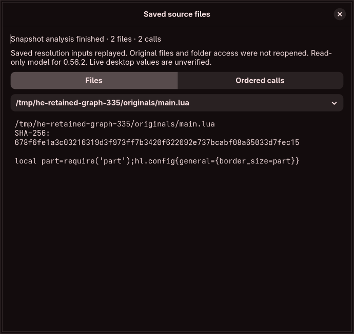

# Retained source graph inputs

Analyze the imported root through **Source Modules → Dependency Files**. After reviewing the result, choose **Keep Analyzed Files in Draft**, then **Save Draft**. Closing dependency review releases its folder handles. The retained bytes remain in the draft and can be undone; they are persisted only by Save Draft. The analyzed root must match the imported root's exact bytes and recorded identity. An unrelated main file cannot silently replace that source context.

Opening the resulting `.hye` file reparses its root and reconstructs the graph in the restricted worker. **Source Modules → View Retained Source Files** shows the rebuilt files and ordered calls. It never opens recorded original paths. Repeated inspection reuses the same window/model; a new graph revision replaces that version’s previous read-only view. The original files may have moved or been deleted. Folder permissions must be selected again for any future live capture.

## Stored inputs and validation

The optional `source_graph` record contains a format/model pin, compiler profile, root ID, supplied main/home/search-path context, optional working directory, document-to-load-name views and loader resolution bindings. Source bytes and origin identities remain in the workspace's existing source records, without a second serialized copy. Distinct load aliases remain distinct views, including aliases of the same inode. Unknown and explicitly empty search paths retain their separate meanings.

The model pin hashes a generated manifest of the core Rust sources, native compilation adapter, application worker/coordinator, dependency lock and bundled model data. CI checks that manifest. Runtime binaries embed the small manifest, rather than all those sources. Reopening requires the same model and compiler profile; cross-profile migration or explicit reanalysis is still required. It preserves the old artifact instead of rewriting its pins.

Validation checks every source identity/hash, unique document/view IDs, root/context agreement, language, resolution source/target IDs, spans, request hashes and byte/count limits. The restricted worker reconstructs requests from the saved source bytes. Each binding must correspond to a reached supplied resolution, and each non-root view must be reached by a loader. Unused bindings or source views are refused. These checks establish consistency of frozen inputs; a hand-edited workspace still cannot certify that a recorded path, missing file or resolution is currently true.

No parser reports, evaluated values, native verification flags, folder descriptors, authorization tokens or live filesystem probe certificates are serialized. Values and expression evidence are rebuilt. Existing worker syscall/resource restrictions and the shared analysis data budget still apply. Source input limits remain 32 views, 4 MiB cumulative bytes, 1 MiB per source and an 8 MiB workspace envelope; retained graph inputs have a separate conservative 8 MiB data-cost ceiling. These are logical bounds, not proof of the project's whole-process memory target.

Graph retention participates in shared bounded undo, version-specific dirty state and save-generation checks. A successful earlier save cannot clear an intervening undo or edit. Saving retains all attached files. Single-root source replacement, reconciliation and source-copy export are refused for a retained graph until the graph editor can preserve dependencies and ownership across those operations. Ordinary value/structured drafts remain separate from the source model and survive save/reopen.

## Evidence and remaining work

Application integration tests reopen both pinned snapshot versions after deleting every original file, preserve independently edited draft values, and reject incompatible compiler/model pins, unknown views, changed bytes/hashes, unreachable bindings/views and root/context mismatches. The graphical workflow captures the actual imported root, retains the graph, closes the capture session, saves/reopens it, exercises undo and late-save guards, and inspects the saved bytes after removing the originals. The existing unrelated-root fixture verifies that retention cannot rebind that root.

This stage does not supply an editable source graph or effective configuration discovery. Full Lua/API/native effects, complete ownership and generated-file analysis, lossless per-file edits/insertion/deletion, graph edit history, multi-file changed-source reconciliation, wildcard resolution, current probe evidence, independently safe persistence placement, isolated compositor preview, guarded apply/recovery and all resource/security/release gates remain required. Partial or stopped model results remain partial when retained. No full audit contract is certified by these tests.
