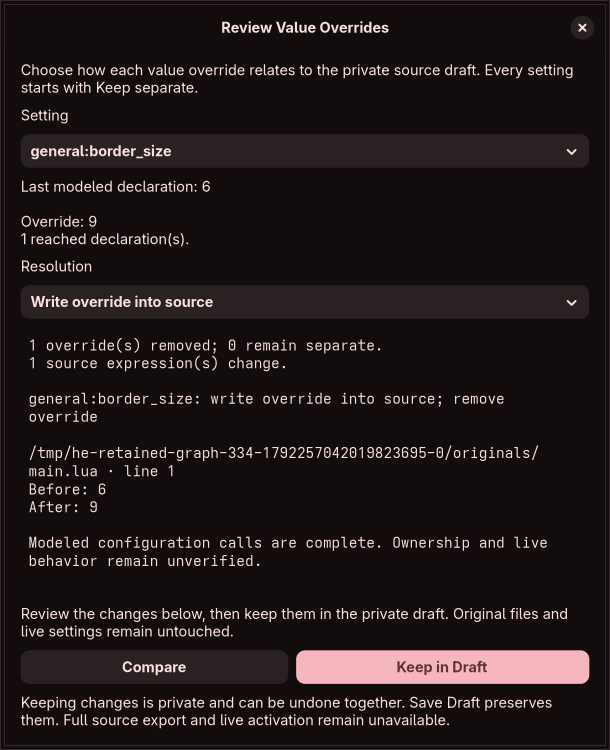

# Review source revisions and scalar overrides

Source analysis now offers **Review Value Overrides**. It shows one setting at a time, its separate override, the last reached modeled declaration (when representable), and the number of reached declarations. The setting selector is searchable. Every row starts with **Keep separate**; equal values are not silently folded.

The choices are:

- **Keep separate** preserves both layers.
- **Use source · remove override** explicitly removes that override. An unresolved source stays unresolved; this action never substitutes a default or asserts an effective value.
- **Write override into source** compares a supported typed override with the last unambiguous reached declaration. The preview shows each changed file, line and before/after expression. Keeping it removes the corresponding override and retains the proposed private source revision together.

Changes require **Compare**, then **Keep in Draft**. Changing a choice invalidates the previous proposal. One within-session undo restores both source and overrides; **Save Draft** persists the resulting layers. Original files/capture identities and live settings are unchanged. **Full source export is still unfinished**, and override-only export remains blocked while source revisions exist, even after all scalar overrides have been reconciled.

## Model and trust boundaries

Review and resolution rebuild the source model in the restricted parser worker; saved reports and GUI rows cannot bypass fresh analysis. Inputs bind the exact source program, schema/compiler profile, override draft and explicit choices. The resolution pins the final program and reduced override map. Pure client checks reject additional layer changes, repeated/unselected edit labels, mismatched input pins and verification claims. They also reject structural declaration intentions in scalar-only plans and missing required source writes. A bounded per-row no-op certificate binds complete modeled scalar analysis and primary-value equality; a result cannot silently drop a Write override choice without its required edit or claim a no-op under incomplete analysis. Trusted Rust piece operations validate and generate the proposed bytes, independently of helper-returned text. Keeping rebuilds syntax and the model from those bytes and checks the final fingerprint again.

Native scalar parsing is shared with graphical source comparison, including named-integer routes. Equality uses native stored values, including float32 bits, rather than assuming draft binary64 values are identical. This distinguishes negative zero while recognizing equivalent float32 representations. It does not establish compositor state or native setter effects.

Scalar inspection follows configuration calls across interleaved monitor declarations. Monitor calls keep their actual trace ordinals and complete argument/effect observations in source comparison, but their tables are not passed to the scalar registry. Unchanged monitor routing does not certify native monitor helper values, inherited state or hardware. Other unsupported APIs and evaluator halts remain analysis boundaries.

Absent declarations are reported only when modeled configuration-call analysis completes without traversal findings, rejected/unmodeled candidates, unsupported APIs or evaluator halts. Otherwise an observed value is provisional, and an unobserved value is unresolved. Writing an override requires the proposed declaration to parse to the intended native value under complete configuration-call analysis. Additional modeled changes (for example, a table expression shared by several declarations) are refused here and require separate source-change review. Matching modeled observations does not prove exclusive ownership or future effects.

Plans are sequential: each pins the immediately preceding private program. Unchanged loader requests receive exact rebased offsets/hashes through the existing piece mechanism. No new path or folder authority is inferred. The current graph and original captures remain retained. A source/override operation shares the existing single-operation permit; background work retains bounded evaluator inputs rather than full graphical analyses. Closure, model replacement, snapshot changes, graph changes or an independently edited draft discard pending results. The combined inverse must fit the existing undo budget before either layer changes.

## Evidence and open scope

Eleven core tests cover both snapshots, explicit choices/default preservation, absence versus unknown, sequential and cross-document changes with loader rebasing, float32 equality/negative zero, rejected primitive repair, shared-effect refusal, scalar/monitor interleaving, monitor-effect removal refusal, stale/tampered inputs and client response checks (including missing writes and structural-intent injection). The actual restricted-worker integration exercises review/resolution and forged/stale inputs. The native graphical workflow exercises initial choices, preview invalidation, both resolution actions, a concurrent-edit rejection, combined undo, private save/reopen without original files, shared capture buffers, closed-analysis release and a 350-pixel minimum width. The history test checks that an oversized combined inverse leaves existing history intact.

This is scalar layer reconciliation, not external multi-file three-way merge. Absent-declaration insertion/deletion, complete accepted-domain controls and complex defaults/derived effects, other feature families, ordinary-form integration, full language/API/native effects, ownership/alias/mount certification, generated configurations, persistent operation history and complete graph/source export remain required. Effective discovery, isolated compositor preview, independent recovery, guarded apply, whole-process memory targets, packaging, accessibility/localization and the entire original audit remain unfinished. No full contract or overall completion percentage is certified.

Writing an override into a direct vector/gap/gradient constructor now uses [layout preservation](compound-source-layout.md). If static keys or source shape cannot establish that transformation, reconciliation refuses without replacing the whole expression. Explicit full-expression editing remains available in the source-change window.
