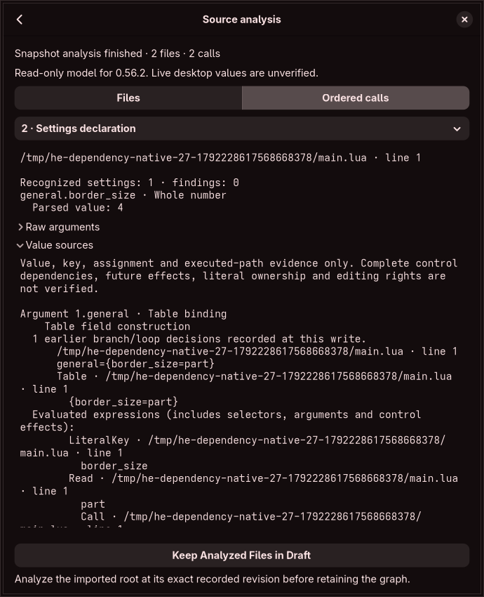

# Modeled keys and assignment history

Source analysis now records writes to modeled local cells and table slots. The **Value sources** disclosure shows their source locations, value forwarding, key expressions, receivers and earlier writes. This is evidence for the source-ownership engine; it does not authorize an edit or a filesystem operation.

The report's `storage_writes` array assigns each write a bounded local ID. A record identifies its modeled cell or table/key, operation, optional source site, prior write, incoming value expression/write, table identity and address-key/receiver evidence. `at_order` places the write before the next modeled API/loader event; the array orders writes within that interval. These IDs are scoped to one immutable analysis and have no runtime-pointer or cross-analysis meaning.

`ExpressionSource.storage_write` identifies the cell/slot that supplied a forwarded value, independently of its selected expression. Table identities remain separate from expression identity. `ValueSource.storage_write` and its parallel row-key records freeze that evidence when arguments are observed. Subsequent mutations cannot rewrite an earlier observation's history.

Each present key row records its first insertion and latest write separately. Equal keys reached through different expressions do not replace the original insertion evidence. Nil table assignments record deletion; reinsertion starts a new present-key lifetime and retains the deletion/prior-write chain. Assigning nil to a local remains an assignment, not a deletion. Named constructor/address keys have a distinct literal-key expression kind; computed keys retain their actual evaluation evidence. Implicit array positions and unmodeled bootstrap key origins do not acquire fabricated literal spans.

Local declarations, ordinary assignments, function bindings, constructor fields, parameter bindings at their call sites, numeric-loop bindings and `rawset` have separate roles. Modeled cache/library writes are explicitly intrinsic and do not claim an editable source location. Lexical shadowing and parameter cells remain distinct even when names/values match. Alias receiver evidence preserves shared table identity. Multi-assignment collision checks continue to compare actual storage addresses, independently of their source metadata.

## Bounds and validation

The worker allows at most 8,192 expression records, 8,192 write records and 32,768 counted expression/write links. Argument trees retain their existing depth/node limits. Tombstone metadata is bounded by the write limit. Record accounting includes separators and reserves the fixed report envelope; a final counting serializer refuses reports exceeding 2 MiB without allocating another full JSON buffer. Budget failures cannot be swallowed by modeled `pcall`, and later calls are not emitted as successful observations.

Core tests cover insertion/overwrite/delete/reinsert, current versus historical keys, shadowed/parameter cells, nil assignments, repeated-address refusal, cached cross-document table aliases, bounded growth and valid backward references. The actual restricted-worker test checks transport of writes and key rows. The graphical workflow checks the new evidence in the existing collapsed disclosure; shared visit/depth/text bounds and deduplication prevent recursive or repeated histories from expanding without limit. Opening history compacts the parsed summary and expands the history pane; retaining the graph remains a fixed action outside the scroll area.

The independent native Lua fixtures now include value copies at mutation checkpoints and a shadow/parameter/nil case: 96 ordered observations across the two pinned snapshots, checked against Lua 5.4.6–5.4.9. The fixture recorder retains tables by reference, so checkpoint fixtures explicitly copy observed scalar values; its final table serialization is not mistaken for an immediate API snapshot. This reference checks values/language behavior, not our source-metadata IDs or complete native configuration effects. Downloaded originals/builds remain temporary.

## Remaining ownership work

[Executed branch/loop history](executed-path-evidence.md) now supplies conservative frozen prefixes, including earlier unrelated choices. Complete control dependencies, callable escapes and future callback effects, all language/native APIs, generated/config-manager ownership, literal exclusivity and edit-impact proofs remain unfinished. Known writes do not prove that every possible write was observed. Intrinsic or unavailable key origins remain unresolved. Native configuration table iteration order and NUL-key collisions keep their existing ambiguity rules.

Graphical source changes still require source-bound patch plans, reparse and intended/unaffected semantic comparisons, shared-value impact review, lossless insertion/deletion and graph history/reconciliation. No live writer, preview compositor, apply/recovery certificate, whole-process memory claim or full audit-contract completion is introduced by these records.
