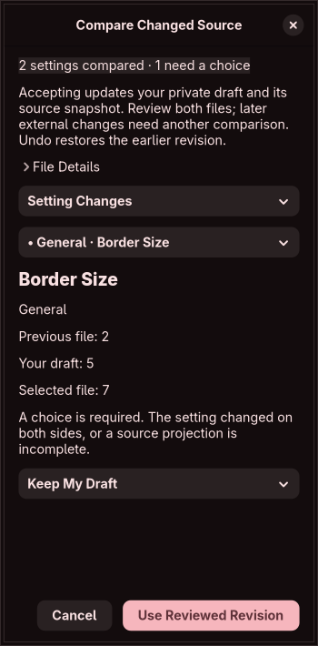

# Interface design rules

The main editing workspace follows the [GNOME Human Interface Guidelines](https://developer.gnome.org/hig/principles.html), using GTK4/libadwaita rather than a second rendering stack. This is an interface refinement of the experimental scalar editor; it does not mark structured controls, apply or isolated preview as complete.

## Navigation and hierarchy

Search and a category filter sit above a recycled setting list. Each row shows a readable name and its category/subcategory, so repeated names retain context. Search accepts both the readable name and the original key. Empty filters explain how to recover.

A desktop window has a sidebar and one selected-setting editor. At 700 logical pixels or less, native `NavigationSplitView` collapses to one page with back navigation. The supported minimum window request is 360 × 480 logical pixels. The Review label disappears at the same breakpoint; its accessible name and tooltip remain. Activating an already selected row reopens its editor after Back.

The selected setting has a short title, description, value origin, a single value card and draft actions. Implementation metadata, source expressions and raw observations remain under a collapsed **Technical Details** disclosure. This follows the HIG's emphasis on focus and progressive disclosure. Long technical strings wrap rather than widening the window.

## Commands and feedback

The [header bar guidance](https://developer.gnome.org/hig/patterns/containers/header-bars.html) informs the two visible actions: Import and Review Draft. Save, Undo, desktop refresh, source-copy review, diagnostics, version choice, feature coverage and draft-mode information are in the main menu. Those commands retain the existing editing and safety boundaries. Review and Undo are disabled when unavailable.

Add to Draft / Update Draft is the suggested action in a setting editor. Remove Override is a secondary action, shown only for an existing override. Validation appears next to the edited value. The bottom status states the draft count and whether there are unsaved changes; the sidebar identifies the selected Hyprland snapshot and draft mode. Version selection has its own dialog and each version retains a separate draft.

| Shortcut | Action |
| --- | --- |
| Ctrl+F | Search settings, returning to the list when collapsed |
| Ctrl+O | Import configuration |
| Ctrl+S | Save the independent draft |
| Ctrl+Z | Undo a staged field or accepted source change |
| Ctrl+Enter | Review the draft |

Names and feedback use the [HIG writing guidance](https://developer.gnome.org/hig/guidelines/writing-style.html). Raw setting keys remain discoverable without appearing as the main title. Curated explanations currently cover common appearance/input settings; other entries have a short generic prompt unless a matching desktop snapshot supplies a description. This is not a claim of complete user-oriented documentation for every scalar.

## Styling, accessibility and resources

Use native spacing, typography, symbolic icons, control states and [system styling](https://developer.gnome.org/hig/guidelines/ui-styling.html). No fixed colors, wallpaper, blur layer, custom font or animation loop is added. The application inherits the system's GTK/libadwaita styling; it has no explicit Caelestia theme integration.

Editing controls have explicit accessible names, including coordinate axes, gap sides and gradient stops. Navigation, menus and controls retain native keyboard behavior. Gradient stops scroll within their card instead of widening the whole window. The main list recycles rows, only the selected setting creates a form, and occasional tools open on demand. No new background process or polling is introduced.

Screen-reader sessions, high-contrast modes, large text and localization still need dedicated certification. Native widget use and spoken labels are a foundation, not an accessibility audit result.

## Extending the editor

Future monitors, bindings, rules and animation editors should get their own focused category surfaces. Keep a summary/list separate from the selected item's controls. Put rare options in a disclosure and group fields by the user's task. Add global header commands only when they belong to the main editing workflow. Runtime apply and isolated preview require the engineering safety gates before they become actionable controls.

A new surface must keep its commands reachable at narrow widths, expose validation alongside its inputs, identify draft versus observed values and preserve unsaved-edit guards. Avoid placing the feature-register or raw source metadata permanently in the main workspace.

## Verification

The native graphical test constructs and validates all 755 version-specific scalar forms, then exercises menu action routing, version changes, staged removal/undo, category and search filtering, disabled Review state, collapsed navigation/reopening and unsaved-close protection. In an isolated Xvfb display it also resizes to 360 pixels and checks that all nine control families fit the allocated width. Checked-in screenshots show the actual native workspace and narrow editor, not a mockup. See [validation](validation.md).

This is an engineering and visual review, not a completed usability study with external users.

## Changed-source comparison

The main menu opens a focused comparison after explicit source selection. A compact page selector switches between setting changes, previous file and selected file. A searchable setting selector marks rows requiring a choice; only one row creates its result control. Automatic independent changes are visible and can be overridden. Unresolved incoming absence has no remove/adopt option. Partial projections require an acknowledgement before acceptance. File identity remains in a collapsed, height-bounded disclosure. Acceptance changes only the private in-memory draft/snapshot; Undo restores both. Native tests cover conflict and partial acknowledgement controls at a 360-pixel window request.

