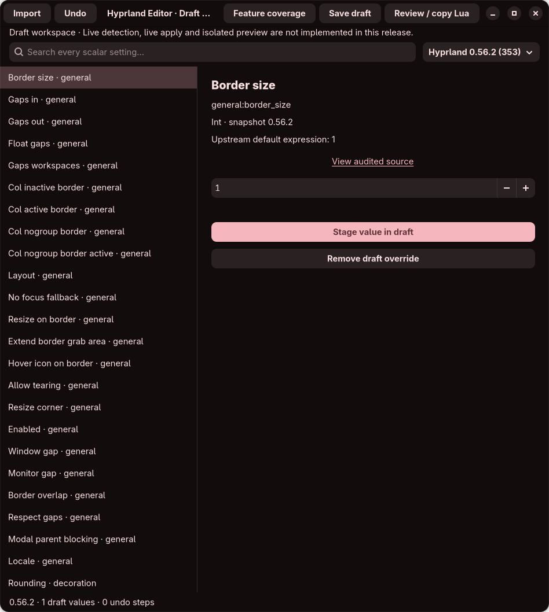
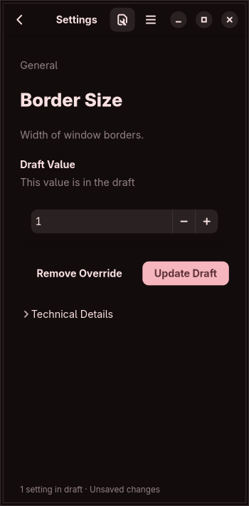

# Initial-build validation

Current repeatable resource observations are in [resource-observations.md](resource-observations.md): three 60-second empty-workspace runs measured 92.3–93.3 MiB PSS and zero recorded CPU ticks. This supersedes the older single startup sample as current evidence, without certifying representative workloads or the full resource gate. Earlier milestone results below remain historical.

Validation date: 13 October 2026. Rust 1.90.0, Linux x86-64, GTK 4.22.5, libadwaita 1.9.4. The local system compiler could not start, so checks used a verified official Rust toolchain isolated inside the ignored development directory; system packages were not modified.

- Release build succeeds with the checked-in lockfile.
- Formatting and strict Clippy checks pass.
- Fifteen core tests cover catalogue membership, codec semantics, string escaping, type/bounds rejection, non-finite numbers, strict draft decoding, round trips, inert legacy import, unresolved overrides, malformed input, private permissions, symlink refusal and FIFO refusal.
- An additional graphical test constructs all 755 version-scoped forms, validates their initial values, exercises staging, snapshot changes, removal and undo, and captures the actual rendered window. It is ignored by ordinary headless tests and run explicitly with a graphical display.
- Metadata checks confirm 353 baseline and 402 audited-main scalar records and 1,453 unique feature contracts. Reproducible generation checks compare application metadata with the checked-in pinned audit.
- The desktop entry passes `desktop-file-validate`. No user configuration was used as a test input, and no compositor setting was changed.

## Resource observation

A single cold release-build run, using GTK's Cairo renderer and an in-memory settings backend, was sampled after two seconds of startup. The main workspace was idle; the feature-register window, import dialogs and preview were not open.

| Measurement | Observation |
| --- | --- |
| PSS | 89,763 KiB (87.7 MiB) |
| RSS | 174,452 KiB (170.4 MiB, including shared library pages) |
| Idle CPU sample | 0 scheduler ticks over 5 seconds |

PSS apportions shared library pages and is the budget metric in the blueprint. This sample is preliminary, not a guarantee. Hardware rendering, multiple workspaces, long editing sessions, large text values, accessibility tools and different GTK versions need independent profiling. A zero-tick sample only establishes that no CPU time was measurable at this sampling resolution.

## Remaining validation

Hosted CI is configured to run build, core and graphical tests, formatting, strict lint and catalogue checks on Ubuntu 24.04. Its results must be assessed independently of this local record. Lossless Lua import, live state inspection, display recovery and preview isolation are not implemented and have no successful runtime certification claim.

## Stage 0.2 validation

The next planned foundation adds static Lua import/source copies and read-only scalar snapshots. Twenty-six core tests, four real parser-process tests, four Unix IPC fixture tests and one graphical test pass locally (35 in total), alongside strict Clippy, formatting and release build checks. The graphical test also verifies that unsaved edits prevent immediate closure. Parser probes confirm that filesystem opens and network sockets are denied after startup; an opaque command fixture cannot create its marker file.

Read-only fixture tests check both allowed request strings, peer/process identity, socket replacement, malformed replies and absolute timeout behavior. The actual host compositor PID is not visible through this local sandbox's `/proc`, so a real host snapshot cannot be certified here. Attachment fails closed rather than bypassing process/peer checks. Real-compositor certification remains a separate milestone. Snapshot strings must be valid JSON; malformed upstream output is not heuristically repaired or replaced with Lua evaluation.

A preliminary idle 0.2 release run measured **88,194 KiB PSS (86.1 MiB)** and **173,924 KiB RSS**, with zero recorded scheduler ticks over five seconds. It used the same Cairo/in-memory-settings setup as the initial sample, with one main workspace, no imported document or live snapshot, and no resident parser child. Shared-page accounting and startup variation make comparisons preliminary. Large imports, open source-review buffers and repeated editing need stress profiling.

See [implementation status](implementation-status.md) for the exact scope, evidence and next gates. The earlier source/audit register has not been relabeled as certified functionality.

Hosted Ubuntu testing exposed immediate socket-inode reuse in the replacement fixture. The repair holds an `O_PATH` descriptor to the original socket node for the entire read session and pins the process with a pidfd. A replacement cannot reuse that pinned filesystem inode; process-exit checks do not rely solely on recycled PID numbers. This change is covered by the original replacement fixture and rechecked in hosted CI.

## Interface redesign validation

The main workspace now follows the [UI design rules](ui-design.md). The same graphical workflow test constructs every scalar form and checks version switching, removal/undo and unsaved-close protection, with added checks for category/search filtering, disabled Review state, menu-to-review routing, initially collapsed technical details and reopening a selected row after returning to search. Repeated notifications for an unchanged search preserve selection.

A verified, privately extracted Xvfb package supplies an isolated display for local rendering checks; no system package or desktop configuration is changed. The test renders at 1100 × 760 and resizes to a 360 × 720 window request (350 × 710 content after decoration). All nine scalar control families fit the content allocation. The hosted graphical test now includes that exact resize check.

The screenshots use the inherited native theme and Cairo renderer. A full accessibility review, translated/large-text layouts and user usability study remain outstanding.

A single idle release-build sample of the redesigned empty workspace on that isolated Xvfb display measured **91,768 KiB PSS (89.6 MiB)** and **175,848 KiB RSS (171.7 MiB)**, with zero scheduler ticks recorded over five seconds. It used Cairo and an in-memory settings backend, sampled two seconds after startup. This is a preliminary observation, not a memory ceiling; the display backend also differs from the earlier desktop sample.

## Source persistence foundation (0.3)

The source-backed workspace path adds six core storage/identity tests, one duplicate-draft-key test and three real-application reopening tests. The application tests execute the actual binary with its restricted parser child: a recorded original path can point to a FIFO without being opened, saved opaque commands cannot create a marker, source snapshots are reparsed, edits survive reopening, and bad hashes, forged report fields and syntax errors are rejected. A mismatched exact catalogue fingerprint is rejected by core validation rather than silently migrated.

The native workflow additionally imports a synthetic source model, saves its draft and identity to a private fixture directory, checks that an identity change is unsaved, and verifies that a save started before a later edit cannot clear that newer edit. All fixtures use synthetic files; no user configuration is an input or output. Native layout checks continue to cover all 755 initial forms and all nine families at narrow width.

The completion-register consistency check tracks all 1,453 full feature contracts, 756 documentation candidates, 24 blueprint sections, 12 work orders, 24 security gates, nine stages and ten shared model invariants. That mechanical check is not a conformance certificate. Watched-path isolation, lossless include/symlink graphs, full source operations, runtime parser certification, preview, hardware recovery and the other outstanding obligations remain unverified.

A source-review regression covers calls hidden in ignored, positional, oversized and nested table fields. Those expressions can affect runtime bindings even when their keys are outside the catalogue. They now mark the source opaque and prevent subsequent API calls from being treated as statically trusted. A real restricted-worker fixture confirms an embedded command stays inert and the later declaration is not falsely imported.

The finalized 0.3 foundation passes 34 core tests, five restricted-parser process tests, three real-application reopening tests, four IPC fixture tests and one explicit native graphical workflow (47 in total), plus formatting, strict Clippy, catalogue generation, completion-register consistency and release build checks locally. Hosted checks are recorded separately for the published revision.

## Explicit symlink source capture

Selected Lua/legacy sources now record symlink chains and resolved leaf identity without following config includes. Six path fixtures cover relative/absolute/directory links, non-UTF-8 targets, cycles, broken links, linked FIFOs, procfs links, trailing-slash semantics and replaced link targets with identical bytes. A workspace fixture deletes the recorded link and target before reopening its saved snapshot. A display fixture checks escaping of newlines, bidi controls, literal backslashes and invalid UTF-8 bytes.

All import readers inspect an `O_PATH` node before opening a regular inode for I/O; workspace/value-draft paths still refuse final-component symlinks. This does not certify hostile concurrent directory mutation, generated-file managers, dependency authorization or remote/FUSE I/O deadlines.

This revision passes 42 core tests, five restricted-parser process tests, three real-application reopening tests, four IPC fixture tests and one explicit native graphical workflow (55 total), plus formatting, strict Clippy, metadata/register consistency and release build checks locally. These checks use synthetic fixtures and an isolated display; no live configuration is modified. Hosted results belong to the exact published commit.

## Single-root source reconciliation (0.4)

Validation date: 14 October 2026 (Asia/Kolkata).

Eight core comparison tests cover independent edits/additions/deletions, false and empty literals, divergent edit/delete conflicts, opaque absence, explicit adoption of a visible partial literal, acknowledgement without scalar rows, report/source/draft staleness, version mixing and refusal to adopt derived projections as literals when opaque code can invalidate cached locals. Three application history tests cover operation/data budgets, shared source allocation accounting, inverse-value scope and oversized-operation refusal without losing existing history. A real-binary comparison fixture restores a saved snapshot, parses an explicitly selected changed/opaque file with restricted children, reports conflicts and proves neither input was written and no embedded command created its marker.

The native workflow checks choice gating, partial acknowledgement, unavailable unresolved adoption, unchanged original files, source/value undo, dirty-state restoration, field undo after a merge, stale-review rejection and both conflict/partial surfaces at narrow width. It exercises fixture models; the separate real-binary check covers worker/process comparison. Local checks pass 51 core tests, three history tests, six parser-process tests, four workspace/comparison application tests, four IPC fixtures and one native graphical workflow (69 total). Formatting, strict Clippy, release build and metadata/register checks are recorded separately for the final revision.

This is static scalar reconciliation for one Lua root, not a general source merge or runtime transaction certificate. The undo data quota estimates owned capacities with shared source de-duplication and conservative structure overhead; allocator overhead, GTK source-review buffers and total process memory are separate. Persistent checkpoint/spill history, stress profiling, full include/scope semantics, multi-file merge and live conflict/recovery testing remain outstanding.

The derived/partial regression also exposed valid Lua semicolons being treated as opaque statements. The pinned grammar defines `empty_statement` as `;`; it now has no effect on static locals/API certainty. A core fixture and a real restricted-process fixture verify semicolon-separated pure declarations remain projectable without executing Lua.

An isolated 0.4 release run for the reconciliation foundation (`678b34d`) measured **107,159 KiB PSS (104.6 MiB)** and **176,928 KiB RSS (172.8 MiB)**, with zero scheduler ticks over five seconds after two seconds of startup. The run used a private Xvfb display and private D-Bus session, Cairo, in-memory settings and empty fixture config/cache/state directories, with one idle empty workspace and no imported source, desktop snapshot, open review or parser child. The app and private bus/display were terminated and fixture directories removed afterwards. **This sample exceeds the 100 MiB PSS target.** Its bus/config setup and shared-page accounting differ from earlier samples, so it does not establish a version-to-version regression. Repeatable resource profiling, large source/review/history stress and memory reductions remain required.

Comparison reviews also pin the complete selected catalogue content. A schema guard fixture changes bounds while preserving all currently valid values, and checks that review acceptance still fails; duplicate IDs and non-finite bounds are refused. Source/report/draft identity alone does not certify that field semantics stayed unchanged.

## Monitor draft editor (0.5)

Verification resumed on 14 October 2026. Checkpoint `9c982c1` passes 57 core tests, four history tests, seven restricted-parser process tests, five workspace/application tests, four read-only IPC fixtures and one explicit graphical workflow (78 total). The local compositor socket fixtures required network permission because the workspace sandbox blocks local Unix sockets; the initial permission-denied run was an environment restriction, and all four affected fixtures passed after permission was granted.

Formatting, strict Clippy, pinned catalogue generation, completion-register consistency and the release build passed. The exact checkpoint also passed [GitHub CI run 38457016554](https://github.com/aman696/hyprland-editor/actions/runs/38457016554), including the hosted graphical test and release build. The final screenshot was inspected after the native test. No host compositor configuration was modified.

Monitor tests cover every audited field in both snapshots through typed Lua export/static import, modes and signed placement, alias/type/schema/boundary rejection, mirror cycles and later clearing, explicit logical geometry, workspace round trips, inert opaque expressions in the real restricted worker, source-versus-draft persistence, undo capacity accounting, and native add/duplicate/reorder/remove/undo/review. Native layout checks cover all 22 monitor forms at 360 pixels; the fixture also exercises diagram drag/undo and private saving of monitor rules alongside source/scalar drafts.

This proves the tested draft behavior, not complete monitor hardware support. No available-mode/EDID inspection, compositor interoperability, monitor source editing/reconciliation, ICC decoding, live apply/recovery or isolated compositor preview is certified. No new 0.5 memory observation was taken; the earlier 104.6 MiB PSS sample remains above the 100 MiB target.

## Device draft editor (0.6)

Validation date: 14 October 2026 (Asia/Kolkata). The device milestone passes 66 core tests, five history tests, nine restricted-worker process tests, six workspace/application tests, four IPC fixtures and one explicit native graphical workflow (91 total). Formatting, strict Clippy, release build and pinned catalogue/completion-register checks pass locally. Hosted verification is tracked for the exact published revision separately.

The new tests cover all 43 device fields in both source snapshots through typed static Lua export/import; numeric curve boundaries; names, typed bounds, linked layout slots, duplicate IDs/keys and schema drift; inert/shadowed API calls; device/source persistence through the actual application; device inverse memory accounting; preservation of author hints without falsely treating them as source edits; and bounded registry XML with no custom/external entities. The actual restricted worker parses synthetic and installed evdev metadata and rejects malicious/oversized registry requests. The installed registry check is conditional on the package file being present and ran locally with 99 layouts and 22 option groups.

Native checks exercise all 43 baseline forms at 360 pixels, ordered CRUD/undo/review, linked layout addition/unset/undo, single-selection keyboard option groups, collapse/reopen with retained selection, custom acceleration and scrolling, tag rows/escaping, private device/scalar/monitor/source saves, the accepted 16 KiB ASCII text boundary, and refusal to truncate oversized layout/tag lists. The unit-test executable is a GTK harness, so its metadata-load path uses the core parser directly; the separate actual-binary tests cover the restricted worker protocol. The rendered device screenshot was inspected after testing. Closing option groups releases their widgets; no periodic refresh/polling is introduced.

A small local C++ probe against installed hyprutils 0.14.2 confirmed four delimiter/backslash tag boundary fixtures. This is narrow parser evidence; it does not certify every dependency version or live device behavior. All configuration fixtures are synthetic. No host compositor setting, keyboard layout, device enablement or source configuration was changed.

The milestone does not close full device contracts: hardware discovery/capabilities, effective global/default merging, source editing/reconciliation, keymap compilation, device-set bind analysis, physical region behavior, guarded input recovery and actual compositor preview still need implementation and verification. No new memory/performance certificate is claimed; the 100 MiB target remains unmet by the latest recorded sample.

The exact device revision `7086adb` passed both hosted [pull-request checks](https://github.com/aman696/hyprland-editor/actions/runs/38519632019) and [branch checks](https://github.com/aman696/hyprland-editor/actions/runs/38519625659), including the native workflow and release build on Ubuntu 24.04. [PR #1](https://github.com/aman696/hyprland-editor/pull/1) was merged as `4c2e81e`. The merge tree is identical to the verified device revision; this is source/build evidence, not physical-device certification.

## Binding/submap draft editor (0.7)

Validation date: 14 October 2026 (Asia/Kolkata). The local workspace suite passes 83 core tests, six history tests, ten actual restricted-worker tests, seven workspace/application tests and four IPC fixtures (110 ordinary tests). The explicit native workflow also passes (111 total), including every reviewed constructor/variant form in both packs, optional values, wheel selection, action-row retention, declaration/submap duplication and undo, escape creation, private graph persistence, exact numeric-selector/large-number preservation and 350-pixel minimum layout checks. Manual chord spelling is retained and removed chord/action controls are checked for callback retention.

The focused recording checks emit synthetic GDK controller events for capture, Escape, blur and unmap; they do not prove physical keyboard/layout interception. The actual parser worker projects captured/deferred actions without running commands and refuses later trusted projection after opaque load-time arguments. The application reopens schema-pinned binding graphs without accessing recorded source paths and rejects schema/order tampering. Core fixtures check empty/nested scopes, flag/version differences, rename/duplication reference handling, inverse restoration and 10,000-record ordered export. That export fixture is not a performance certificate or maximum-size source reimport proof.

Formatting, strict Clippy, scalar/action/binding metadata checks, completion-register consistency and the release build pass locally. The private graphical display is terminated by the test runner; the final binding screenshot was inspected. Local socket fixtures needed execution-sandbox socket permission. No actual compositor configuration, shortcut, dispatcher or physical device was modified. Hosted evidence will be recorded for the exact published commit after CI runs.

Complete selector/message/shortcut builders, visual workflows, effective conflicts/device targeting, source-preserving bind edits/reconciliation, actual compositor parser/behavior tests, isolated preview, guarded live apply/recovery and release-wide certification remain open. This milestone certifies only the listed draft tests. No new memory ceiling is claimed; the latest recorded PSS observation remains above the 100 MiB target.

The exact binding revision `e059489` passed hosted [pull-request checks](https://github.com/aman696/hyprland-editor/actions/runs/38538976611) and [branch checks](https://github.com/aman696/hyprland-editor/actions/runs/38538871460), including the native workflow, strict checks and release build on Ubuntu 24.04. [PR #2](https://github.com/aman696/hyprland-editor/pull/2) was merged as `465c2d1`; its tree is identical to the verified revision. Temporary downloaded binding source references were removed after their hashes matched the published provenance. These results certify the listed draft checks, not live compositor behavior.

## Workspace draft editor (0.8)

Validation date: 14 October 2026 (Asia/Kolkata). The local workspace suite passes 89 core tests, six history tests, eleven restricted-worker tests, eight workspace/application tests and four IPC fixtures (118 ordinary tests). The explicit native workflow also passes (119 total), including all 15 workspace field forms, enabled state, CRUD/undo, private persistence, retained non-string layout options, selector spelling and 350-pixel minimum layout checks. Removed workspace controls release their references. The final native screenshot was inspected.

The restricted worker projects workspace declarations without executing an empty-workspace hook; application reopen retains workspace drafts and refuses schema tampering without opening recorded paths. Core tests cover every field's static round trip, filter clause kinds/boundaries, opaque load-time arguments, strict IDs/options and literal consolidation. Two source-extracted C++ probes, using SHA-256-pinned baseline/current functions with inert mock data, pass default ordering, enabled retention, empty-monitor non-replacement, zero/false/empty optional overrides and option union. They do not test real Lua conversion, workspace/monitor matching or compositor behavior.

Formatting, strict Clippy, catalogue/action/register checks and the release build pass locally. Parser reports now use a boxed worker response, reducing enum size without changing the JSON envelope. No actual workspace, layout, empty hook or original configuration was activated. Private display teardown completes through the native runner. Hosted verification will be recorded for the final exact commit.

Complete selectors/layout/custom-option/animation/command builders, source codecs, effective-state inspection, persistent creation, hardware, isolated preview, safe apply/recovery, accessibility, packaging and memory/resource certification remain open. The last recorded PSS sample still exceeds the 100 MiB target; no new ceiling is claimed here. The original full-goal register remains unproven.

Exact workspace revision `4af2f6b` passed hosted [pull-request checks](https://github.com/aman696/hyprland-editor/actions/runs/38546201325) and [branch checks](https://github.com/aman696/hyprland-editor/actions/runs/38546031946), including both C++ source probes, native workflow, strict checks and release build on Ubuntu 24.04. [PR #3](https://github.com/aman696/hyprland-editor/pull/3) was merged as `5ba9ecd`; its source tree is identical to the tested revision. Temporary downloaded workspace/layout source references were removed after verification. This remains draft/source evidence, not runtime or hardware certification.

## Gesture draft editor (0.12)

Validation date: 15 October 2026 (Asia/Kolkata). The local suite passes 116 core, six history, thirteen restricted-worker, eleven actual-application workspace and four IPC tests (150 ordinary tests), plus the private-display graphical workflow (151 total). New interaction cases cover ordered CRUD/unset/undo, invalid scale navigation/close guards, phase presence and action blocks, signed/current versus baseline scale, unchanged aliases/coercible representations, export/import, private gesture saving and closed-editor draft release. The latter caught a list-refresh reference cycle; the final weak-reference implementation passes.

All 144 gesture binding/descriptor/registration/payload source observations pass. Direct callback interfaces use synthetic data with inert services and built-in constructors; native input routing/inhibition, renderer effects, VM timeout guards and userdata ABI remain unverified. Canonical JSON sorting avoids treating unspecified Lua table iteration order as an observation difference. The corrected animation error adapter retains all 170 existing observations. Parameter-name round trips and generated-action name collisions have explicit regression cases.

Formatting, strict lint, release build, catalogue/action/register checks and visual review pass. The selected matching/action layout fits the tested 700×760 window; broader accessibility/adaptive coverage remains required. Private display teardown completed. Completed gesture audit source downloads were deleted, retaining provenance and fixtures. No live configuration, action or physical device was changed. No new memory ceiling or idle-CPU certificate is claimed.

Published through [PR #7](https://github.com/aman696/hyprland-editor/pull/7), exact head `b0b8132659ef7bab1c610af5585aee1ceded7d84`. Both hosted workflows passed source probes, workspace/native tests, strict lint and release build: [push run](https://github.com/aman696/hyprland-editor/actions/runs/38760609389) and [PR run](https://github.com/aman696/hyprland-editor/actions/runs/38760620862). Merge `ec8d62dc726a3ccde648a5a299bc4841447d2491` has the identical tested source tree `432f12305cf539a165d05b153690effa53f0a13c`. These checks certify the listed draft evidence, not the full product.

The register now has partial feature foundations for 662/1,453 contracts (45.6%); zero full contracts have release-wide acceptance. General workflows, complete codecs, lossless source graph/ownership/insertion/deletion, effective discovery, isolated preview, guarded apply/recovery, resource targets and packaging/release gates remain required.

## Retained source graph workspace inputs

Validation date: 17 October 2026 (Asia/Kolkata). The local workspace suite passes 244 ordinary tests. Three actual-application integration tests reopen both pinned snapshot versions after deletion of the originals, retain independently edited scalar draft values, and reject altered compiler/model pins, source hashes, load views, request inputs, unreachable source views and root/context disagreement. Multi-file artifacts without explicit graph inputs remain refused.

The private-display workflow exercises actual graph capture/retention, root-revision rejection, closing the capture session, private save, graph reopen, undo and stale-save guards. It also opens the saved-file inspector after removing the originals. These cases extend the existing graphical test (245 local tests including that workflow), rather than certifying native compositor behavior. Model inputs pin 44 source/data files through a generated manifest without embedding their full text in the runtime. The full editable graph, source ownership/reconciliation, live discovery/preview/recovery and resource/security/release obligations remain open. Hosted verification belongs to the exact published PR revision; local success is not a hosted result.

## Modeled key and storage-write evidence

Local validation on 17 October 2026 adds four core storage tests and one graphical-description unit test to the ordinary suite: 249 ordinary tests plus the private-display workflow (250 total). Checks cover distinct key introduction/latest-write roles, tombstones/reinsertion, lexical shadowing/parameters, nil assignments, same-address refusal, cached cross-document aliases, worker transport, bounded references and the 2 MiB serialized report ceiling. The graphical workflow verifies the new evidence inside Value sources, with no source or live setting edits.

The independent native suite now has 96 ordered observations per Lua release. All four pinned Lua 5.4.6–5.4.9 runs pass the ordered/compiler checks, 108 path/normalization observations and 592 primitive scalar observations per release. Mutation checkpoints copy scalar values so the fixture's retained table references cannot substitute final contents for earlier observations. This checks the fixture language/value behavior, not a complete ownership or compositor-effect contract. Temporary originals/builds are removed. Whole-process resource and original release/security gates remain unproven.

## Executed branch and loop evidence

Local checks add four core path-history cases and one graphical-description case: 254 ordinary tests plus the private-display workflow (255 total). Conditions, short-circuit timing, loop body/test order, numeric boundaries, frozen write/call/load prefixes, module documents, caught errors/returns and budget failure are checked. The actual parser-worker transports the new evidence, and the private graphical workflow inspects a condition-dependent settings declaration. The updated screenshot is visually inspected. Strict lint, formatting, generated model/register checks and release build cover this revision. These checks establish the listed model behavior, not complete source control dependencies or an editing certificate.

Two trusted reference programs cover the branch/short-circuit and numeric/while/repeat boundary values independently in actual Lua. The ordered suite now has 100 observations per release; all four pinned Lua 5.4.6–5.4.9 releases must match those fixtures, the existing 108 path/normalization observations and 592 primitive scalar observations. Source-metadata identities are independently bounded/tested in the Rust model, not claimed as native Lua output. Reference originals/builds are temporary and deleted. See [scope and limits](executed-path-evidence.md). Hosted checks belong to the exact published revision; a local result is not a hosted pass.

## Immutable source edit-plan backend

Local validation adds nine core source-edit cases and one actual restricted-worker case: 264 ordinary tests plus the existing private-display workflow (265 total). Tests exercise exact old-byte/context/schema/compiler pins, preservation of UTF-8/comments/CRLF/unaffected declarations, insertions/deletions, shared-value impact and before/after snapshots, branch/call-site and loader changes, stale/overlapping/foreign inputs, unreached-file syntax failures, partial models, signed zero, size/depth budgets and a counterexample where an unexecuted future effect prevents any ownership/runtime claim even though observed calls match. Strict lint, formatting, generated catalogue/model/register checks and release build pass for the local revision.

The parser worker returns the same pure patch review as the core engine and refuses a changed old-byte hash. It retains existing syscall/resource isolation. The native graphical run verifies existing workflows; a graphical source-edit form and persistence of edited graph revisions are still required and are not certified by that regression. No live source file is edited, and source ownership/effective discovery/isolated compositor preview/apply/recovery/security/resource/release gates remain unproven. The ordered model's existing 100 independent native observations remain unchanged and pass in the ordinary suite; this step does not add native source-effect or compositor certificates. [Edit-plan scope](source-edit-plans.md) explains the remaining requirements.

## Graphical primitive source comparisons

Local checks on 17 October 2026 pass 270 ordinary tests and the extended private-display workflow (271 total), strict lint, formatting, generated catalogue/model/register checks and release build. Five new core cases cover selected-expression versus shared original literal impact, computed expression replacement, version-specific native constraints, bad coordinates/types/nonfinite results, float kind/signed zero/integer minimum/string printers and cross-document branch effects. A real worker case independently rebuilds the typed setting coordinates and matches the core comparison result.

The native workflow opens the comparison through Source analysis, changes exact numeric controls, rejects input/model changes while work is in flight, verifies original-literal impact, closes/reopens/reuses the window and checks unchanged source files and draft generation. It exercises numeric preservation and choice selection. The 350-pixel minimum required explicitly setting the toolkit window minimum; reducing title/button text alone did not resolve that default. The final rendered window is visually inspected. This is a source-comparison GUI, not saved graph edits or an isolated compositor preview.

All four hash-pinned Lua 5.4.6–5.4.9 profiles pass the existing 100 ordered, 108 path/normalization and 592 primitive parser observations per release, plus the new trusted library-free literal-printer check for floating kind, signed zero, integer minimum and escaped string bytes. Temporary original archives/builds are removed. No user source is executed, and neither source ownership nor runtime verification is granted. See [scope and remaining work](source-change-gui.md). Hosted verification belongs to the exact new published revision, separately from these local results.

### Source-comparison task lifetime repair

At exact head `5dca7a2f005f3578be00c54d8e0a67abf8888bd6`, the hosted push run passed but the PR run failed the immediate closed-inspector analysis-release assertion. The source-comparison background closure retained the entire `Analysis` while it only needed an independent evaluator `Program`. The repair clones that input before launching the task, so closing releases source captures/reports immediately even while the bounded worker continues. A test-only hold now keeps the comparison in flight until after the original release assertion, making this regression deterministic without weakening the assertion or waiting away retention. The repaired native workflow and strict lint pass locally; the ordinary test count stays 270 plus one native workflow (271). The production lifetime repair was also release-built. Hosted verification belongs to the repaired exact head.

## Private piece-based source revisions

Local checks pass 277 ordinary tests plus the extended graphical workflow (278 total), strict lint, formatting, generated catalogue/model/register checks and release build. Five new core cases exercise piece sharing, byte preservation, restoration, loader rebasing/refusal, incomplete models, forged metadata, stale plans and limits/syntax. A real worker case checks application/materialization and hash refusal. An application save/reopen case covers both audited versions with originals deleted, original identities preserved and separate overrides retained.

The native workflow keeps a source change through the actual GUI, verifies immutable shared captures, rejects a concurrent draft edit, preserves its separate override, blocks partial override export, saves/reopens and exercises undo/late-save behavior. The resulting source view shows current private bytes alongside original captures and was visually inspected. In-memory undo is not persistent operation history. The model/source manifest now pins 49 reconstruction inputs.

All four pinned Lua 5.4.6–5.4.9 reference profiles still pass 100 ordered, 108 path/normalization and 592 primitive parser observations per release plus the trusted primitive literal-printer checks. Original archives/builds and the private display are cleaned up. Piece sharing, streaming serialization and logical retained-data budgets do not certify the 100 MiB process target. Full graph reconciliation, source ownership/future effects, persistent history, complete family editors, discovery/preview/apply/recovery and every original release/security gate remain unproven. [Revision scope](private-source-revisions.md) distinguishes this implementation from those requirements.
