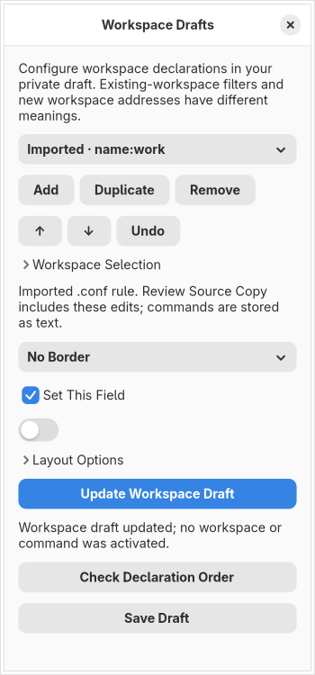

# Workspace rule editing

Open **Menu → Edit Workspaces** to edit ordered private workspace declarations. Choose a rule and one field at a time. **Set This Field** distinguishes an override from absence; explicit false, zero and empty values remain distinct. Add, duplicate, reorder, remove and undo stage changes in memory. Save Draft keeps the captured source and graphical drafts in a private project. Commands remain text and no workspace is created while editing.

## Existing `.conf` files

Import a `.conf` file to populate supported literal `workspace = …` declarations. The shared forms expose all 14 fields represented by the pinned native handler: animation, border size, decoration, default flag, default name, inner/outer gaps, layout, monitor, disable border/rounding/shadow, empty-workspace command and persistence. Native `border`, `shadow` and `rounding` values invert into the disable controls. There is no native `float_gaps` or `enabled` field; these controls are excluded for imported rules.

Repeated selectors stay separate and ordered. This preserves the declarations for review rather than pretending they are the effective state of a live workspace. Field and rule switches keep valid edits; invalid forms block switching. Hooks retain the raw source command argument, without calling the native command-cleaning helper or executing anything.

**Review Source Copy** combines these edits with supported scalar, environment/startup, monitor and shortcut changes. Review the complete new file before saving it separately. Untouched statements, comments, line endings and unresolved declarations remain in the copy. Edited statements use native field spellings and are reparsed before publication. Native substring-dispatch precedence is checked; a value that would be interpreted as another field is refused. Unknown options retain the entire declaration as unresolved instead of partially overwriting it.

Current projects retain deliberate removal of every workspace rule. Older projects without the source/codec markers rebuild recognized source rules and retain their separate Lua drafts with distinct identities. Reopening does not access the original paths or change old files. Separate Lua drafts require an explicit conversion before native source export; implicit conversion is refused. Ordinary preview preparation records native-rule omission without emitting selector, output, hook or option payloads.

## Layout options and Lua drafts

Expand **Layout Options** to add, rename, change or remove options. Only one option form is shown at a time. Orientation and direction offer common choices; custom text remains available. Native `layoutopt:name:value` options keep string values, including an empty string or additional colons in the value. Lua drafts support text, boolean, whole-number and finite-number values. Imported types survive unchanged edits. Invalid numbers block switching without losing the entered text.

Lua drafts retain all 15 audited fields and the optional enabled override. Supported static Lua declarations can also be edited through the captured source workflow described in [source declaration editing](source-declaration-editing.md). Combined file review is described in [combined project copies](combined-project-copy.md).

## Selection and limits

Workspace Selection offers numbered, named and special addresses and AND filters for existing workspaces. Action/navigation queries have a different grammar. Unrecognized imported selectors remain literal; the builder does not certify native matching or the existence of a workspace/output.

Policies bound declarations to 1,024 rules, 128 options per rule and 1 MiB serialized data. The source parser also bounds the retained projection incrementally. These are finite input limits, not a measured whole-application memory ceiling.

Variables, includes, expressions, conditional/continued/qualified syntax and unknown native field spellings remain retained/unresolved. Complete selectors, dynamic semantics, layout-specific validation, effective discovery, actual isolated compositor preview, live apply/recovery, resource/accessibility/security and release acceptance remain required. These workflows do not complete the full WORKSPACE audit contracts.

The native mapping follows the pinned [workspace handler](https://github.com/hyprwm/Hyprland/blob/efb50993780079460b0cbed1363e2166a2de1d9f/src/config/legacy/ConfigManager.cpp#L1553), identified in `data/legacy-workspaces.json`. The [workspace source-model evidence](workspace-source-model.md) documents the separate source/runtime reference work.
